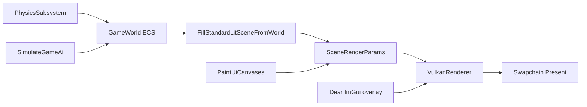

# Engine Capabilities

This chapter is a **subsystem map** of Spark: what ships in the engine tree, how pieces connect at runtime, and where to drill down in later parts of the guide. Everything listed here has working coverage in **SparkDemo** or unit tests unless marked experimental.

## Runtime architecture



| Stage | Responsibility | Typical entry API |
|-------|----------------|-------------------|
| Input | GLFW poll + semantic actions | `IInput`, `PlayerInputComponent` |
| Simulation | Components, physics, AI | `GameWorld::UpdateGameObjects`, `PhysicsSubsystem` |
| Audio | Mixer pump + spatial cues | `SoundEngine`, `ProcessSoundCues` |
| UI input | Retained canvases | `ProcessUiCanvasesInput` |
| Render collect | ECS → GPU descriptors | `FillStandardLitSceneFromWorld` |
| Present | HDR, tonemap, swapchain | `IEngineContext::SetSceneRenderParams` |

Deep dives: [2D render pipeline](../2-2d-graphics/06-2d-render-pipeline.md), [Meshes and Materials](../3-3d-graphics/01-meshes-and-materials.md).

## UI toolkits

| Stack | When to use | Key APIs |
|-------|-------------|----------|
| **Spark UI** (retained, `spark/ui/`) | Menus, editor chrome, themed HUD | `UiCanvasComponent`, `ProcessUiCanvasesInput`, `PaintUiCanvases` |
| **Dear ImGui** (optional, `SPARK_ENABLE_IMGUI`) | Docking tools, debug panels | `IImGuiLayer`, `Ui::UiToolkitSettings` |

Full guide: [UI and Toolkits](08-ui-and-toolkits.md).

## 3D rendering

| Feature | Types / components |
|---------|-------------------|
| Forward PBR | `MaterialComponent`, `SceneShadingModel::LitPbr` |
| Toon / cel | `SceneShadingModel::ToonCel` |
| Directional + CSM | Sun vector + `SceneRenderParams` shadow fields |
| Point / spot lights | `PointLightComponent`, `SpotLightComponent` |
| Skinned characters | `SkinnedMeshComponent`, `AnimatorComponent`, `AttachmentSocketComponent` |
| Decals / volumes | `DecalProjectorComponent`, `FogVolumeComponent`, `PostProcessVolumeComponent` |
| Camera rigs | `CameraComponent`, `SpringArm3DComponent`, `CameraFollow3DComponent` |
| Time of day | `TimeOfDayDriverComponent` |
| Terrain / water / sky | `TerrainComponent`, `WaterBodyComponent`, `SkyComponent` |
| Particles + VFX | `ParticleEmitterComponent`, `VfxPlayerComponent` |
| IBL / SSAO | Fields on `SceneRenderParams` |

## 2D rendering

| Feature | Types |
|---------|-------|
| Sprites | `SpriteComponent` → `SceneSpriteDraw` (8192/frame, 16 texture layers) |
| Animation | `SpriteAnimatorComponent`, `Sprite2DCharacterAnimFsmComponent`, hitbox/event components |
| Tilemaps | `TilemapComponent` + gameplay grid, TMX import, colliders |
| Camera stack | `Camera2DComponent`, `Camera2DRigComponent`, `ScreenShakeComponent`, `ParallaxLayerComponent` |
| 2D lighting | `SpriteLighting2DComponent` modes in `sprite.frag` |
| Sprite-layer particles | `ParticleRenderSpace::SpriteLayer` |

See [Sprites](../2-2d-graphics/01-sprites.md) through [2D Lighting](../2-2d-graphics/05-2d-lighting.md).

## 2D gameplay components (built-in)

Platformer-ready ECS: `CharacterController2DComponent`, `InputActionMapComponent`, `GameStateComponent`, `GridNavAgent2DComponent`, `HealthComponent`, `PickupComponent`, and more — catalogued in [Game Component Reference](07-game-component-reference.md).

## Gameplay kit (`spark/gameplay/`)

Shared C++ helpers for teams, damage routing, interaction, and inventory — [Gameplay kit](09-gameplay-kit.md).

## Concept: run physics + AI in a frame

Physics is **explicit**: `Game::OnUpdate` does not call `Simulate2D` for you. AI and sound cues have dedicated processors.

### C++

```cpp
#include "spark/physics/PhysicsSubsystem.hpp"
#include "spark/ai/GameAi.hpp"

PhysicsSubsystem physics;

void OnUpdate(const FrameTiming& timing, IEngineContext& context) override {
    Game::OnUpdate(timing, context);  // components + ProcessSoundCues
    physics.Simulate2D(GetWorld(), timing);
    physics.SimulateAll3D(GetWorld(), timing);
    SimulateGameAi(GetWorld(), timing, context);
}
```

### C\#

```csharp
public override void OnUpdate(FrameTiming timing, IEngineContext context)
{
    base.OnUpdate(timing, context);
    _physics.Simulate2D(World, timing);
    _physics.SimulateAll3D(World, timing);
    GameAi.Simulate(World, timing, context);
}
```

### Python

```python
def on_update(self, timing: FrameTiming, context: EngineContext) -> None:
    super().on_update(timing, context)
    context.physics.simulate_2d(self.world, timing)
    # 3D / AI when exposed by host template
```

## Concept: load assets through `WorldAssets`

Use **`world.Assets()`** (C#: **`world.Assets`**). Caches are keyed strings shared by render submit (`RegisterMesh` / `RegisterTexture`).

### C++

```cpp
GltfAsset asset = world.Assets().LoadGltf("assets/models/Crate.glb");
SkinnedGltfAsset fox = world.Assets().LoadSkinnedGltf("assets/models/Fox.glb");
SharedPtr<Texture2D> tex = world.Assets().LoadTexture("assets/sprites/player.png");
world.Assets().RegisterMesh(mesh, "my_game/hero");
world.Assets().RegisterTexture(tex, "my_game/hero_albedo");
```

### C\#

```csharp
var asset = world.Assets.LoadGltf("assets/models/Crate.glb");
var fox = world.Assets.LoadSkinnedGltf("assets/models/Fox.glb");
world.Assets.RegisterTextureFromFile("my_game/hero_albedo", "assets/sprites/player.png");
```

### Python

```python
world.load_texture("assets/sprites/player.png", key="my_game/hero_albedo")
world.register_checkerboard_texture("debug/checker", c0, c1)
```

## Scripting surface

| Language | Repo / package | Binding source |
|----------|----------------|----------------|
| C++ | This repo | Native headers |
| C\# | **spark-sharp** | `component-script-catalog.json` → generated `Spark.Bindings` |
| Python | **spark-python** | Same catalog → interop + `spark` package |

Roughly **120** built-in components are scriptable when listed in the catalog — see [Building and Running](03-building-and-running.md) and `docs/site/docs/component-script-codegen.html`.

## Where capabilities are proven

| Subsystem | SparkDemo anchor |
|-----------|------------------|
| 2D platformer | #6 `Platformer2DDemo` |
| Tilemaps + pathfinding | #19 `TilemapShowcase2DDemo` |
| glTF PBR + IBL | #21 `GltfSamples3DDemo` |
| Physics 3D | #29 `PhysicsShowcase3DDemo` |
| VFX library | #3 `VfxShowcaseDemo` |
| ImGui tools | #20 `ImGuiShowcaseDemo` |

Legacy free functions (`SimulatePhysics2D`, …) remain but are **deprecated** — use `PhysicsSubsystem`.

Next: [Building and Running](03-building-and-running.md).
