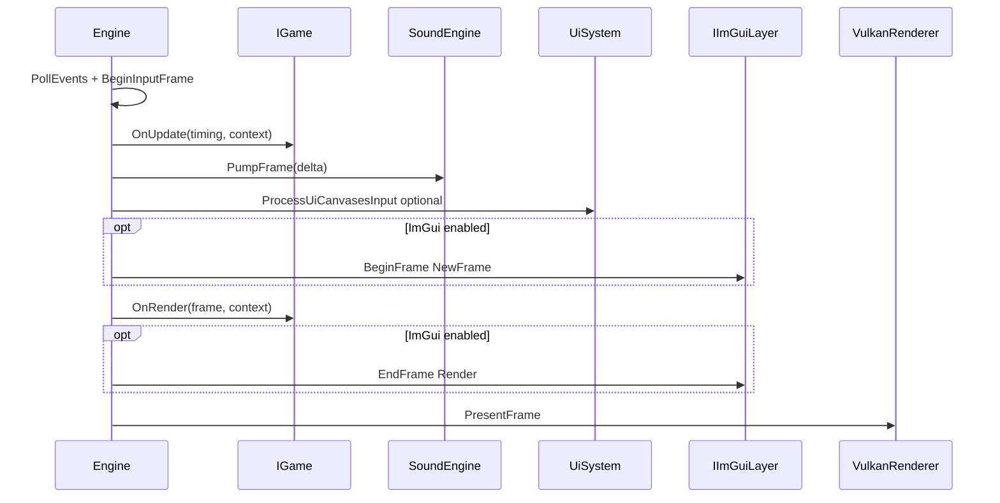

# The Engine Loop

The loop in `Spark::Engine::Run()` (`spark/engine/Engine.cpp`) is fixed: **poll input → simulate → audio pump → render → present**. Games plug in through `IGame`; they must not call Vulkan directly.

## Class design: `Engine`

| Responsibility | Detail |
|----------------|--------|
| Owns `IGame` | Destroyed on shutdown |
| Owns `VulkanRenderer` | Implements `IFramePresenter` |
| Owns `SoundEngine` | Pumped each frame |
| Drives loop | Poll → Update → Audio → Render → Present |

```cpp
class Engine {
public:
    explicit Engine(UniquePtr<IGame> game);
    void Run();

    template<typename GameType, typename... Args>
    static UniquePtr<IGame> NewGame(Args&&... args);
};
```

## Frame sequence



**ImGui rule:** build all `ImGui::Begin` / widget code inside **`OnRender`**, not `OnUpdate`. Retained Spark UI uses `ProcessUiCanvasesInput` during update and `PaintUiCanvases` when assembling `SceneRenderParams` — see [UI and Toolkits](08-ui-and-toolkits.md).

## Canonical frame order (facets)

Reference implementations:

| Demo | Role |
|------|------|
| **`Platformer2DDemo`** (#6) | 2D: input → `Physics().Simulate2D` → `RunGameplaySlice` → rules → `Rendering().SubmitLitWithCamera` |
| **`GltfSamples3DDemo`** (#21) | 3D: fly camera → `Rendering().FillLit` + custom `SceneRenderParams` |
| **`Game` base class** | Default `OnUpdate`: `GetWorld().Simulation().RunDefaultSlice` |

`RunDefaultSlice` runs **component `OnUpdate`**, **`ProcessVfx`**, and **`SoundSubsystem::ProcessFrame`** — it does **not** step physics or AI. Call those explicitly in the order your game requires.

### `Game` / single `IGame` subclass

```cpp
void MyGame::OnUpdate(const FrameTiming& timing, IEngineContext& context) override {
    // 1) Input and rules that must run before component ticks (optional).
    ReadInputAndSetIntent(context);

    // 2) Default slice: components, VFX, audio cues.
    GetWorld().Simulation().RunDefaultSlice(timing, context);

    // 3) Physics (after controllers wrote intent, if you simulate after components).
    GetWorld().Physics(physics).Simulate2D(timing);  // or Simulate3D / SimulateAll3D

    // 4) Post-physics gameplay (2D pickups / interactables when SPARK_HAS_GAMEPLAY).
    GetWorld().Simulation().RunGameplaySlice();

    // 5) Optional AI (not in RunDefaultSlice).
    GetWorld().Simulation().RunAi(timing, context);
}
```

Order varies by genre — **platformer** refreshes input *before* physics and calls `RunDefaultSlice` *after* `Simulate` via the shell (see SparkDemo below).

### SparkDemo shell (`Game` + `Simulate` hook)

Launcher games implement `Simulate` **then** the shell calls `Game::OnUpdate` → `RunDefaultSlice`:

```text
Simulate()     — demo rules, physics, AI (whatever this sample needs)
Game::OnUpdate — RunDefaultSlice (components, VFX, audio)
OnRender       — world.Rendering().SubmitLit* / FillLit + SetSceneRenderParams
```

Do **not** call `ProcessVfx` or `UpdateGameObjects` manually in demos on this path — that duplicates `RunDefaultSlice`. Exception: immediate VFX feedback (e.g. button “play effect”) may call `world.Simulation().ProcessVfx()` once.

### Render

| Pattern | API |
|---------|-----|
| Fixed camera matrices | `world.Rendering().SubmitLit(context, viewProj, camPos, options)` |
| Main `Camera2D` / `Camera` in ECS | `world.Rendering().SubmitLitWithCamera(context, options)` |
| Custom fog / IBL / overlays after fill | `world.Rendering().FillLit(..., params)` then patch `params` and `context.SetSceneRenderParams` |

Build lighting with `LitSceneSubmitOptions` (`WithDirectionalLight`, `WithParticles`, `WithSceneTime`, …).

## `FrameTiming`

```cpp
struct FrameTiming {
    float deltaTimeSeconds;   // Motion integration — always use this
    float totalTimeSeconds;   // Since engine start
    std::uint64_t frameIndex;
};
```

Clamp gameplay logic if you need fixed step; physics showcase demos use `PhysicsSubsystem` internal sub-stepping.

## `IEngineContext` facade

Stable API hiding renderer/window implementation:

```cpp
Window& GetWindow();
IInput& GetInput();
void GetFramebufferSize(int& outWidth, int& outHeight) const;
void SetSceneRenderParams(const SceneRenderParams& params);
IImGuiLayer* TryGetImGuiLayer() noexcept;
SoundEngine* TryGetSoundEngine() noexcept;
Scene* TryGetScene() noexcept;
```

Script hosts expose a subset through `EngineContext` (Python) or `IEngineContext` (C\#).

## Concept: handle quit + debug keys

### C++

```cpp
void OnUpdate(const FrameTiming& timing, IEngineContext& context) override {
    IInput& in = context.GetInput();
    if (in.IsKeyPressedThisFrame(GLFW_KEY_ESCAPE))
        glfwSetWindowShouldClose(context.GetWindow().Handle(), GLFW_TRUE);
    Game::OnUpdate(timing, context);
}
```

### C\#

```csharp
public override void OnUpdate(FrameTiming timing, IEngineContext context)
{
    if (context.GetInput().IsKeyPressedThisFrame(Key.Escape))
        context.GetWindow().RequestClose();
    base.OnUpdate(timing, context);
}
```

### Python

```python
def on_update(self, timing: FrameTiming, context: EngineContext) -> None:
    inp = context.get_input()
    if inp.is_key_pressed_this_frame(Key.ESCAPE):
        context.request_close()
```

## Concept: drive render from `OnRender`

### C++

```cpp
void OnRender(IRenderFrame&, IEngineContext& context) override {
    LitSceneSubmitOptions opts{};
    opts.WithDirectionalLight(sunDir, sunColor, sunIntensity)
        .WithAmbient(ambient)
        .WithParticles(true, camRight, camUp)
        .WithSceneTime(sceneTimeSeconds);
    GetWorld().Rendering().SubmitLitWithCamera(context, opts);
}
```

### C\#

```csharp
public override void OnRender(IRenderFrame frame, IEngineContext context)
{
    var opts = new LitSceneSubmitOptions()
        .WithDirectionalLight(SunDir, SunColor, Intensity)
        .WithAmbient(Ambient)
        .WithParticles(true)
        .WithSceneTime(_sceneTime);
    World.Rendering.SubmitLitWithCamera(context, opts);
}
```

### Python

```python
def on_render(self, context: EngineContext) -> None:
    # Native host or template calls FillStandardLitSceneFromWorld after updates.
    pass
```

Custom fly-camera games must build `viewProjection` manually (see [IGame and Game](05-igame-contract.md) and `GltfSamples3DDemo`).

## Screenshots and recording

- **F12** — async PNG to `SPARK_BUILD_ASSETS_DIR/screenshots/spark_YYYYMMDD_HHMMSS.png` (engine-internal binding).
- **F9** — MP4 recording toggle (see root `README.md`).

On macOS, prefer in-engine **F12** over system capture (MoltenVK windows often record black externally).

## Legacy vs facet quick map

| Prefer | Legacy (still valid) |
|--------|----------------------|
| `world.Simulation().RunDefaultSlice` | `UpdateGameObjects` + separate VFX/audio |
| `world.Physics(physics).Simulate2D/3D` | `physics.Simulate2D(world, …)` |
| `world.Rendering().SubmitLit` / `FillLit` | `SubmitStandardLitSceneFromWorld` |
| `world.Simulation().RunAi` | `SimulateGameAi` / `AiSubsystem::RunFrame` |

See also `docs/API_POLISH.md`.

## Demo shell shortcuts

When running **SparkDemo**: **TAB** menu, **H** help, **F3** FPS. These are implemented in the shell, not in individual demos.

Next: [IGame and Game](05-igame-contract.md).