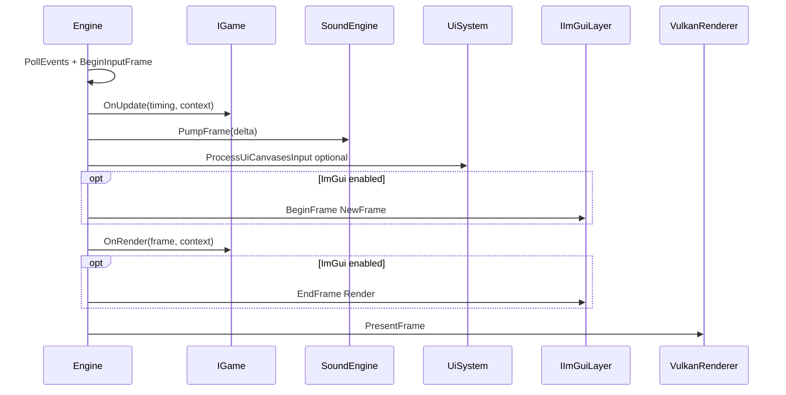

# The Engine Loop

The loop in `Spark::Engine::Run()` (`spark/engine/Engine.cpp`) is fixed: **poll input → simulate → audio pump → render → present**. Games plug in through `IGame`; they must not call Vulkan directly.

## Class design: `Engine`

| Responsibility | Detail |
|----------------|--------|
| Owns `IGame` | Destroyed on shutdown |
| Owns `VulkanRenderer` | Implements `IFramePresenter` |
| Owns `SoundEngine` | Pumped each frame |
| Drives loop | Poll → Update → Audio → Render → Present |

```cpp
class Engine {
public:
    explicit Engine(UniquePtr<IGame> game);
    void Run();

    template<typename GameType, typename... Args>
    static UniquePtr<IGame> NewGame(Args&&... args);
};
```

## Frame sequence



**ImGui rule:** build all `ImGui::Begin` / widget code inside **`OnRender`**, not `OnUpdate`. Retained Spark UI uses `ProcessUiCanvasesInput` during update and `PaintUiCanvases` when assembling `SceneRenderParams` — see [UI and Toolkits](08-ui-and-toolkits.md).

## `FrameTiming`

```cpp
struct FrameTiming {
    float deltaTimeSeconds;   // Motion integration — always use this
    float totalTimeSeconds;   // Since engine start
    std::uint64_t frameIndex;
};
```

Clamp gameplay logic if you need fixed step; physics showcase demos use `PhysicsSubsystem` internal sub-stepping.

## `IEngineContext` facade

Stable API hiding renderer/window implementation:

```cpp
Window& GetWindow();
IInput& GetInput();
void GetFramebufferSize(int& outWidth, int& outHeight) const;
void SetSceneRenderParams(const SceneRenderParams& params);
IImGuiLayer* TryGetImGuiLayer() noexcept;
SoundEngine* TryGetSoundEngine() noexcept;
Scene* TryGetScene() noexcept;
```

Script hosts expose a subset through `EngineContext` (Python) or `IEngineContext` (C\#).

## Concept: handle quit + debug keys

### C++

```cpp
void OnUpdate(const FrameTiming& timing, IEngineContext& context) override {
    IInput& in = context.GetInput();
    if (in.IsKeyPressedThisFrame(GLFW_KEY_ESCAPE))
        glfwSetWindowShouldClose(context.GetWindow().Handle(), GLFW_TRUE);
    Game::OnUpdate(timing, context);
}
```

### C\#

```csharp
public override void OnUpdate(FrameTiming timing, IEngineContext context)
{
    if (context.GetInput().IsKeyPressedThisFrame(Key.Escape))
        context.GetWindow().RequestClose();
    base.OnUpdate(timing, context);
}
```

### Python

```python
def on_update(self, timing: FrameTiming, context: EngineContext) -> None:
    inp = context.get_input()
    if inp.is_key_pressed_this_frame(Key.ESCAPE):
        context.request_close()
```

## Concept: drive render from `OnRender`

### C++

```cpp
void OnRender(IRenderFrame&, IEngineContext& context) override {
    SubmitStandardLitSceneFromWorldWithCamera(
        GetWorld(), context,
        sunDir, sunColor, sunIntensity, ambient,
        enableParticles, sceneTimeSeconds);
}
```

### C\#

```csharp
public override void OnRender(IRenderFrame frame, IEngineContext context)
{
    SceneSubmit.SubmitStandardLitSceneFromWorldWithCamera(
        World, context, SunDir, SunColor, Intensity, Ambient,
        enableParticles: true, _sceneTime);
}
```

### Python

```python
def on_render(self, context: EngineContext) -> None:
    # Native host or template calls FillStandardLitSceneFromWorld after updates.
    pass
```

Custom fly-camera games must build `viewProjection` manually (see [IGame and Game](05-igame-contract.md)).

## Screenshots and recording

- **F12** — async PNG to `SPARK_BUILD_ASSETS_DIR/screenshots/spark_YYYYMMDD_HHMMSS.png` (engine-internal binding).
- **F9** — MP4 recording toggle (see root `README.md`).

On macOS, prefer in-engine **F12** over system capture (MoltenVK windows often record black externally).

## Recommended order inside `OnUpdate`

1. Read input / write velocities.
2. `Game::OnUpdate` (components, animation, sound cue prep).
3. `PhysicsSubsystem::Simulate2D` / `SimulateAll3D`.
4. Game rules (scoring, spawns) that depend on physics results.
5. Optional: `SimulateGameAi`, `ProcessVfx`, async `world.Assets().Pump()`.

Rendering never mutates physics state — only reads transforms after simulation.

## Demo shell shortcuts

When running **SparkDemo**: **TAB** menu, **H** help, **F3** FPS. These are implemented in the shell, not in individual demos.

Next: [IGame and Game](05-igame-contract.md).
