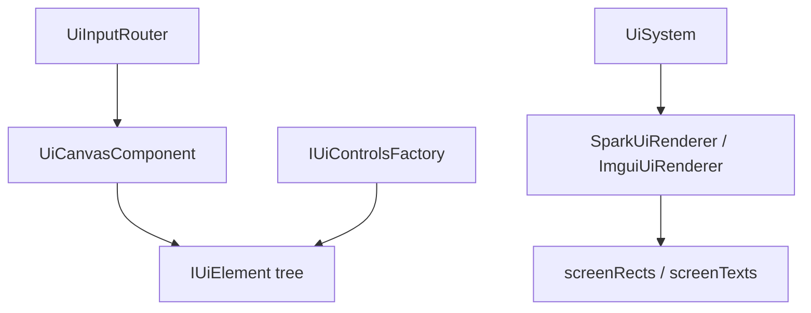
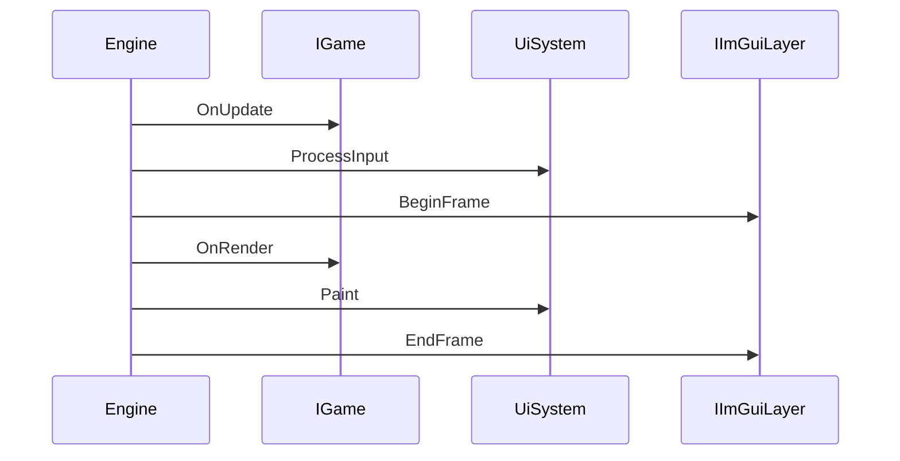

# UI and Toolkits

Spark UI lives in **`spark/ui/`** (`#include "spark/ui/Ui.hpp"`). The stack is **retained-mode**: build an **`IUiElement`** tree on **`UiCanvasComponent`**, route input each frame, paint into **`SceneRenderParams`** for the Vulkan screen-UI pass.

Two **backends** share factory interfaces:

| Backend | `UiBackendKind` | Factory | Best for |
|---------|-----------------|---------|----------|
| **Spark native** | `SparkNative` | `SparkUiControlsFactory` | Shipped menus, themed HUD |
| **Dear ImGui retained** | `DearImGui` | `DearImguiControlsFactory` | Docking tools, rapid editors |

Both compile when **`SPARK_ENABLE_IMGUI=ON`** (default). Use **`Ui::UiToolkitSettings`** to choose pointer/keyboard routing.

See also [`GUI_TOOLKIT_ARCHITECTURE.md`](../../../GUI_TOOLKIT_ARCHITECTURE.md), [`GUI_EDITOR_ROADMAP.md`](../../../GUI_EDITOR_ROADMAP.md).

## Architecture



| Piece | Role |
|-------|------|
| `UiCanvasComponent` | Canvas root, sort order, focus |
| `ProcessUiCanvasesInput` | Hit-test + focus (`UiScene.hpp`) |
| `PaintUiCanvases` | Emit draw lists into `SceneRenderParams` |
| `UiConsumesGamePointer()` | Gate gameplay picking when UI captures pointer |

## Concept: pause menu canvas

### C++

```cpp
#include "spark/ui/Ui.hpp"
#include "spark/ecs/components/ui/UiCanvasComponent.hpp"

Ui::IUiControlsFactory& factory =
    Ui::UiSystem::Get().GetActiveBackendPtr()->GetControlsFactory();

Ui::PanelDesc panelDesc{};
panelDesc.id = Utf8String("menu");
panelDesc.title = Utf8String("Pause");
panelDesc.centerInParent = true;
panelDesc.width = 280.0F;
auto panel = factory.CreatePanel(panelDesc);

Ui::ButtonDesc btnDesc{};
btnDesc.id = Utf8String("resume");
btnDesc.label = Utf8String("Resume");
auto btn = factory.CreateButton(btnDesc);
Ui::UiVoidCallback resumeCb{};
resumeCb.fn = [](void* ctx) { *static_cast<bool*>(ctx) = false; };
btn->SetOnClick(resumeCb);
Ui::AdoptUiChild(*panel, MoveTemp(btn));

GameObject* uiRoot = world.CreateGameObject();
UiCanvasComponent* canvas = uiRoot->AddComponent<UiCanvasComponent>();
canvas->SetRoot(MoveTemp(panel));
canvas->SetTheme(Ui::UiTheme::ClassicMint());
```

### C\#

```csharp
// Use generated UiCanvasComponent mirror when available; otherwise build from native bootstrap in template.
var uiRoot = world.CreateGameObject("UI");
var canvas = uiRoot.AddUiCanvas();
// Populate via UiSystem factory from Spark.Scripting helpers in spark-sharp samples.
```

### Python

```python
# UiCanvas often mounted from native demo; extend when spark-python exposes Ui bindings.
ui_root = world.create_game_object("UI")
```

## Concept: per-frame input + paint

Call **input** after polling (typically end of `OnUpdate`):

### C++

```cpp
void OnUpdate(const FrameTiming& t, IEngineContext& ctx) override {
    int fbW = 0, fbH = 0;
    ctx.GetFramebufferSize(fbW, fbH);
    ProcessUiCanvasesInput(GetWorld(), ctx.GetInput(), fbW, fbH, 1.0F, 1.0F);

    if (!UiScrollWheelConsumed()) {
        // camera zoom
    }
    if (!UiConsumesGamePointer()) {
        // viewport gameplay pick
    }
    Game::OnUpdate(t, ctx);
}
```

**Paint** when building scene params in `OnRender`:

```cpp
SceneRenderParams params{};
FillStandardLitSceneFromWorld(..., params);
PaintUiCanvases(GetWorld(), params, fbW, fbH);
ctx.SetSceneRenderParams(params);
```

### C\#

```csharp
ProcessUiCanvasesInput(World, context.GetInput(), fbW, fbH, 1f, 1f);
// ...
PaintUiCanvases(World, p, fbW, fbH);
```

### Python

```python
# Delegated to native host when UI is enabled in template.
```

## Input gating helpers

| Function | Purpose |
|----------|---------|
| `UiConsumesGamePointer()` | UI owns gameplay pointer |
| `UiPointerOverUi()` | Cursor over chrome — skip world pick |
| `UiScrollWheelConsumed()` | UI ate scroll — skip camera zoom |

## Switching backends (tool mode)

### C++

```cpp
#include "spark/ui/runtime/UiToolkitSettings.hpp"

Ui::UiToolkitSettings::SetPreferred(Ui::UiBackendKind::DearImGui);
// tool work…
Ui::UiToolkitSettings::SetPreferred(Ui::UiBackendKind::SparkNative);
```

### C\#

```csharp
UiToolkitSettings.SetPreferred(UiBackendKind.DearImGui);
```

### Python

```python
# Native-only today unless exposed by host.
```

## Dear ImGui immediate layer

CMake **`SPARK_ENABLE_IMGUI`** links docking ImGui + Vulkan backend.

### C++

```cpp
void OnRender(IRenderFrame&, IEngineContext& context) override {
    if (IImGuiLayer* imgui = context.TryGetImGuiLayer()) {
        if (imgui->IsAvailable() && imgui->IsEnabled()) {
            ImGui::Begin("Debug");
            ImGui::Text("FPS: %.1f", 1.0f / dt);
            ImGui::End();
        }
    }
    SubmitStandardLitSceneFromWorld(...);
}
```

**Rules:** no `ImGui::Begin` in `OnUpdate`; engine calls `NewFrame` after update.

### C\#

Use `context.TryGetImGuiLayer()` from bindings when hosting tool demos.

### Python

ImGui not typical in Python host — use retained UI or native tool mode.

## Engine frame order (both UI stacks)



## Demos

| Demo | Item | Notes |
|------|------|-------|
| Scene editor | **#10** | [Part 10](../10-tools-and-workflows/01-scene-editor-3d.md) |
| ImGui docking | #20, key **G** | [Part 10](../10-tools-and-workflows/02-dear-imgui-and-tool-ui.md) |
| Spark editor | **#24**, key **E** | [Editor direction](../10-tools-and-workflows/03-spark-editor-direction.md) |
| Shell help HUD | **H** | `DemoHelpHud` → `screenTexts`, not `UiCanvas` |

Disable ImGui: `cmake … -DSPARK_ENABLE_IMGUI=OFF` → `TryGetImGuiLayer()` is null.

## Choosing a toolkit

| Spark native | Dear ImGui |
|--------------|------------|
| Themed game menus | Profilers, temp editors |
| Saved scenes with `UiCanvasComponent` | Docking IDE layouts |
| `TreeView`, scroll panels | ImGui ecosystem widgets |

`UiCanvasComponent` field reference continues in the long-form sections of [Game Component Reference — UI](07-game-component-reference.md#ui).

Next: [Gameplay kit](09-gameplay-kit.md) · Part 2: [Sprites](../2-2d-graphics/01-sprites.md).
