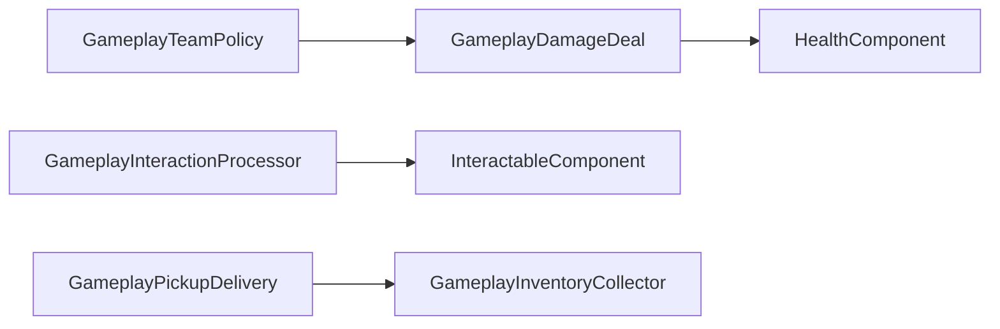

# Gameplay kit (`spark/gameplay/`)

The gameplay kit is **plain C++** helpers shared by demos — not a scripting VM. Components own state (`HealthComponent`, `PickupComponent`, …); the kit routes **damage**, **interaction**, and **inventory** with consistent team policy.

**Umbrella include:** `#include "spark/gameplay/GameplayKit.hpp"`  
**Tests:** `tests/gameplay/GameplayKitTest.cpp`

C\# can call the same logic through component methods and signals; Python uses mirrored components where generated.

## Module map



---

## Teams

| Type | Role |
|------|------|
| `GameplayTeamId` | `int32` team id (`0` neutral) |
| `GameplayTeamComponent` | Team on object; walks parents via `GameplayTeamAffiliation::Resolve` |
| `GameplayTeamPolicy` | Friendly-fire rules (`AllowsHostileAction`) |

`Combat2DTarget` / `Combat3DTarget` apply damage through `GameplayDamageDeal` (friendly fire **off** by default).

### Concept: team-tagged combatants

#### C++

```cpp
#include "spark/ecs/components/gameplay/GameplayTeamComponent.hpp"
#include "spark/gameplay/Combat3D.hpp"

player->AddComponent<GameplayTeamComponent>()->SetTeamId(1);
enemy->AddComponent<GameplayTeamComponent>()->SetTeamId(2);

Combat3DTarget target{*enemy};
const float applied = target.ApplyDamage(player, 25.0F);  // 0 if same team
```

#### C\#

```csharp
player.AddGameplayTeam().SetTeamId(1);
enemy.AddGameplayTeam().SetTeamId(2);
var applied = new Combat3DTarget(enemy).ApplyDamage(player, 25f);
```

#### Python

```python
player.add_gameplay_team().set_team_id(1)
enemy.add_gameplay_team().set_team_id(2)
# Apply damage via HealthComponent or combat helpers when bound.
```

**Demo:** `CharacterCameraDemo` — player team `1`, dummies team `2`.

---

## Damage pipeline

| Type | Role |
|------|------|
| `GameplayDamageApplier` | Walks hierarchy for `DamageableComponent` / `HealthComponent` |
| `GameplayDamageDeal` | Instigator + policy + raw damage → applied amount |
| `GameplayDamageEvent` | View of `SignalId::DamageApplied` |
| `Combat2DTarget` / `Combat3DTarget` | Entry points with hurtbox rules |

Components still emit **`SignalId::DamageApplied`** and **`SignalId::Died`**.

### Concept: listen for damage

#### C++

```cpp
#include "spark/gameplay/GameplayDamageEvent.hpp"

void OnSignal(GameObject& owner, SignalId id, const SignalPayload& payload) override {
    GameplayDamageEvent evt{};
    if (GameplayDamageEvent::TryFromSignal(id, payload, evt)) {
        const float amount = evt.GetAppliedAmount();
        GameObject* instigator = evt.GetInstigator();
        (void)amount;
        (void)instigator;
    }
}
```

#### C\#

```csharp
if (GameplayDamageEvent.TryFromSignal(id, payload, out var evt))
{
    var amount = evt.AppliedAmount;
}
```

#### Python

```python
# Handle SignalId.DAMAGE_APPLIED in on_signal when payload exposes damage struct.
```

**Game-specific layers** (armor, crit, hitstop) build on `GameplayDamageDeal` or component multipliers.

---

## Interaction

| Type | Role |
|------|------|
| `GameplayInteractionQuery` | Nearest `InteractableComponent` that `CanInteract(instigator)` |
| `GameplayInteractionProcessor` | `ProcessInteractPress(world, instigator)` |
| `ProcessInteractables2D` | 2D demo wrapper |

Pair `InteractableComponent` with `TriggerVolume2DComponent` for range, or set `SetInteractionRadius`.

### Concept: press to interact

#### C++

```cpp
#include "spark/gameplay/GameplayInteractionProcessor.hpp"

if (context.GetInput().IsKeyPressedThisFrame(GLFW_KEY_E)) {
    GameplayInteractionProcessor::ProcessInteractPress(world, player);
}
```

#### C\#

```csharp
if (input.IsKeyPressedThisFrame(Key.E))
    GameplayInteractionProcessor.ProcessInteractPress(World, player);
```

#### Python

```python
if inp.is_key_pressed_this_frame(Key.E):
    gameplay.process_interact_press(world, player)
```

---

## Inventory hooks

| Type | Role |
|------|------|
| `IGameplayInventorySink` | Backend `TryReceive(GameplayItemStack)` |
| `GameplayInventoryCollectorComponent` | Player collector; emits `ItemCollected` |
| `GameplayPickupDelivery` | Delivers pickup to collector hierarchy |
| `GameplayItemStack` | `itemId` + `quantity` |

### Concept: gem pickup

#### C++

```cpp
player->AddComponent<GameplayInventoryCollectorComponent>();
player->GetComponent<GameplayInventoryCollectorComponent>()->SetOnItemReceived(
    [](GameObject& owner, const GameplayItemStack& stack) {
        (void)owner;
        (void)stack;
    });

gem->AddComponent<PickupComponent>()->SetItemId("gem");
// Without custom callback, TryCollect uses GameplayPickupDelivery.
```

#### C\#

```csharp
player.AddGameplayInventoryCollector()
    .SetOnItemReceived((owner, stack) => { });
gem.AddPickup().SetItemId("gem");
```

#### Python

```python
player.add_gameplay_inventory_collector()
gem.add_pickup().set_item_id("gem")
```

---

## Related combat headers

- **2D:** `Combat2D.hpp`, `Interaction2D.hpp`, `DamageZone2DComponent`, hurtbox queries.
- **3D:** `Combat3D.hpp`, `Hurtbox3DComponent`, `AnimationMeleeHitComponent`.

ECS field reference: [Game Component Reference — Gameplay](07-game-component-reference.md#gameplay).  
2D product path: [2D gameplay API guide](../8-2d-game/09-2d-gameplay-api-guide.md).

**Part 1 complete** → Part 2: [Sprites](../2-2d-graphics/01-sprites.md).
