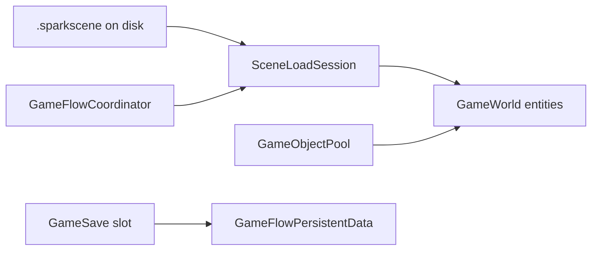

# Scenes, prefabs, and saves

Spark separates **runtime ECS** (`GameWorld`) from **authored scene files** (`.sparkscene`) and **versioned save slots** (`GameSave`). The P0 2D demo (**#26 / F**) is the reference integration: level load, pools, flow state, and persistence.

Related: [P0 2D path](../8-2d-game/07-p0-2d-product-path.md) · [2D gameplay API §11](../8-2d-game/09-2d-gameplay-api-guide.md#11-game-flow-saves-and-hud).

## Mental model



| Artifact | Role |
|----------|------|
| `.sparkscene` | Entity/component snapshot (level, prefab, UI scene) |
| `SceneLoadSession` | Owns active `SceneInstanceId`, unload/reload |
| `SceneLevelLoader` | Template: load path + find primary entity / spawn pose |
| `GameObjectPool` | Warm/acquire/release prefab instances by scene key |
| `GameSave` | Opaque `spark_save_v1` file for cross-session progress |

## Concept: load a level scene

### C++

```cpp
#include "spark/scene/editor/SceneLevelLoader.hpp"
#include "spark/scene/core/SceneLoadSession.hpp"

SceneLoadSession session(sceneManager);

SceneLevelLoadResult result = SceneLevelLoader(session).Load(
    world,
    "levels/platformer_level.sparkscene",
    [](GameWorld& w, SceneInstanceId id) -> GameObject* {
        return w.FindGameObjectByName("Level");
    },
    "PlayerSpawn");

if (!result.success) {
    // fallback: procedural spawn
}
```

`SpawnPointService` resolves named `spawn_point` entities inside the loaded instance.

### C\#

```csharp
// Scene loading APIs are primarily C++ today; C# games often embed levels
// in OnAttach or call native helpers added to SparkInterop as needed.
var player = World.CreateGameObject("Player");
player.GetOrAddTransform().SetTranslation(spawnPos);
```

### Python

```python
# Prefer hosting GameFlow2DProductPathDemo via native binary until
# SceneLevelLoader is bound in spark-python.
```

## Concept: prefab pool

### C++

```cpp
#include "spark/scene/spawn/GameObjectPool.hpp"

GameObjectPool pool(sceneManager);
pool.Warm(world, sceneManager, "prefabs/p0_gem.sparkscene", poolSize);

GameObject* gem = pool.Acquire(world, "prefabs/p0_gem.sparkscene", nullptr);
// ... gameplay ...
pool.Release("prefabs/p0_gem.sparkscene", gem);
```

P0 gems use `PickupComponent::SetDestroyOwnerOnCollect(false)` so dissolve FX can finish before `Release`.

### C\#

```csharp
// Pool warm/acquire typically C++-hosted in product-path template.
```

### Python

```python
pass  # pools not yet exposed — use C++ coordinator or extend interop
```

## Concept: game flow across scenes

| Type | API |
|------|-----|
| Per-level state | `GameStateComponent` |
| Triggers | `GameFlowTriggerComponent` |
| Coordinator | `GameFlowCoordinator` — reload, additive UI scenes |
| Persistent totals | `GameFlowPersistentData` ↔ `GameSaveSlot` |

### C++

```cpp
#include "spark/save/GameSave.hpp"

GameSaveSlot slot{};
if (GameSave::TryLoad(GameSave::DefaultSlotPath(), slot)) {
    persistent.ApplyFromSlot(slot);
}
// On checkpoint:
persistent.WriteToSlot(slot);
GameSave::TrySave(GameSave::DefaultSlotPath(), slot);
```

### C\#

```csharp
// GameSave I/O C++-first; sync progress from GameState transitions in template games.
```

## Serialization and round-trip

Component handlers (e.g. `ComponentSnapshotHandlersGameFlow.cpp`) register which `ComponentKind` values survive capture/reload. Integration test: `PlatformerLevelSceneRoundTripTest` loads `platformer_level.sparkscene`, captures, and verifies TMX path + player spawn.

When adding a new gameplay component to scenes:

1. Implement snapshot read/write in the handler set used by your scene template.  
2. Add a round-trip or load test beside existing level tests.  
3. Document fields in [component reference](07-game-component-reference.md).

## Tilemaps in scenes

Level roots often pair:

- `TilemapMapSourceComponent` (TMX path)  
- `TilemapComponent` + `TilemapCollider2DComponent` + `TilemapGameplayGridComponent`

See [Tilemaps](../2-2d-graphics/03-tilemaps.md) and [Tilemap edit roadmap](../2-2d-graphics/04-tilemap-editor-roadmap.md) (programming APIs vs Phase D editor UX).

Next: [Assets and content pipeline](12-assets-and-content-pipeline.md).
