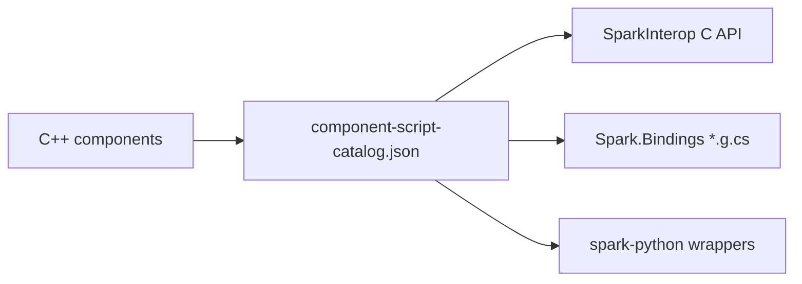

# Scripting and bindings

Spark gameplay is **native C++ ECS first**. Optional hosts run **C\#** (`spark-sharp` + CoreCLR) and **Python** (`spark-python`) against the same components via generated interop.

Deep docs (outside this part):

| Document | Topic |
|----------|--------|
| [SPARK_SHARP.md](../../SPARK_SHARP.md) | Repo layout, CMake presets |
| [CSHARP_SCRIPTING.md](../../CSHARP_SCRIPTING.md) | `SparkScriptHost`, `HelloCsGame` |
| [COMPONENT_SCRIPT_CODEGEN.md](../../COMPONENT_SCRIPT_CODEGEN.md) | `component-script-catalog.json` → C ABI |
| [BINDINGS_COVERAGE.md](../../BINDINGS_COVERAGE.md) | What is / is not mirrored to C\# |

This chapter summarizes **how to work safely** in each language without duplicating those references.

## Single source of truth



1. Add or change a scriptable method in the catalog.  
2. Regenerate (`spark-sharp/tools/generate-csharp-bindings.sh`, python stubs as documented in repos).  
3. Update [component reference](07-game-component-reference.md) and relevant [Part 7](../7-game-components-usage/00-introduction.md) chapter.

## Concept: C\# game entry

### C++

```cpp
// Native bootstrap only — your game may be entirely managed:
// SparkScriptHost loads assembly and calls managed Game::OnAttach.
```

### C\#

```csharp
public sealed class MyGame : Game
{
    public override void OnAttach(IEngineContext context)
    {
        var go = World.CreateGameObject("Player");
        go.GetOrAddTransform();
        go.AddRigidbody2D(RigidbodyBodyType2D.Dynamic, 1f);
    }
}

public static class Program
{
    public static void Main() => SparkScriptHost.Run<MyGame>();
}
```

### Python

```python
from spark import Game

class MyGame(Game):
    def on_attach(self, context):
        self.world.create_game_object("Player").get_or_add_transform()
```

## Concept: attach components from scripts

| Task | C\# | Python |
|------|----|--------|
| Known helper | `go.AddSprite(...)` | `go.add_sprite(...)` |
| Any `ComponentKind` | `GetOrAddComponent<T>()` | `get_or_add_default_component(ComponentKind.X)` |
| Field not bound | Signal / native callback | Same — extend catalog or C++ gameplay module |

### C\#

```csharp
player.AddCharacterController2D().SetMaxRunSpeed(7.5f);
```

### Python

```python
from spark._generated.component_kind import ComponentKind
player.get_or_add_default_component(ComponentKind.CharacterController2D)
```

## Intentionally C++-only (today)

Patterns skipped by bindgen (see [BINDINGS_COVERAGE.md](../../BINDINGS_COVERAGE.md)):

| Pattern | Workaround |
|---------|------------|
| `std::function` callbacks on components | `SignalId` on managed `Game` |
| Methods taking `GameObject& owner` for world queries | Use owner handle from your script |
| `SharedPtr` constructors for assets | `RegisterMesh` / `AddMesh` mirrors in `CppMirrors.g.cs` |
| Scene load / pool / some editor APIs | Keep in C++ `Game` or add SparkInterop exports |

## Signals vs polling

Prefer **`PlayerInputComponent`** and semantic actions over raw GLFW in gameplay code — works the same in C++ `Simulate` and in C\# `OnUpdate` when components are mirrored.

### C++

```cpp
if (playerInput->WasActionPressedThisFrame("Jump"))
    controller->RequestJump();
```

### C\#

```csharp
if (input.WasActionPressedThisFrame("Jump"))
    controller.RequestJump();
```

### Python

```python
# Bindings for PlayerInput vary — check spark-python for generated methods.
```

## Python honesty

`spark-python` exposes a **subset** of `add_*` helpers. For uncovered kinds, use `ComponentKind` + default component stubs, or host C++ demos for full P0/scene flows until bindings land.

## Where examples live in this guide

- **Part 7** — per-family C++ / C\# / Python attach recipes  
- **Parts 8–9** — walkthroughs with script fallbacks called out  
- **Part 1 ch.07** — full field tables (language-agnostic names)

Next: [Debugging & diagnostics](14-debugging-and-diagnostics.md) · [Arcade single-file games](15-arcade-single-file-games.md) · [Part 2 — 2D graphics](../2-2d-graphics/01-sprites.md).
