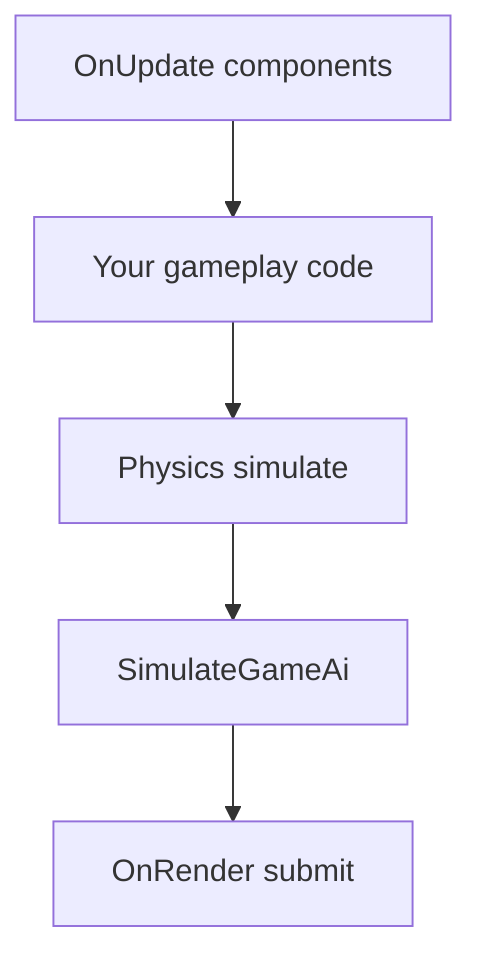

# Debugging and diagnostics

Spark keeps most debugging **in-process**: help overlays, FPS readout, validation layers, and subsystem ordering checks. This chapter consolidates patterns repeated across SparkDemo walkthroughs so you do not hunt every Part for the same checklist.

**Related:** [Building and running](03-building-and-running.md) · [Engine loop](04-engine-loop.md) · [`ARCHITECTURE_AND_DEVELOPER_GUIDE.md`](../../ARCHITECTURE_AND_DEVELOPER_GUIDE.md) (contributor depth).

## SparkDemo overlay toolkit

| Tool | Key | Implementation |
|------|-----|----------------|
| Help HUD | **H** | `DemoHelpHud` → `SceneRenderParams::screenTexts` |
| FPS overlay | **F3** | `DemoFpsToggleOverlay` (shell + `ToggleDemoFpsOverlayVisible`) |
| Launcher | **TAB** | `SparkShellDemo` catalog |
| Screenshot | **F12** | `assets/screenshots/` (see [Building](03-building-and-running.md)) |
| Video | **F9** | In-engine recorder (when enabled in build) |

`DemoHelpHud` patches screen text instead of spawning transient `TextOverlayComponent` trees — avoids ECS lifetime issues when toggling visibility.

### Concept: mount help in your demo

#### C++

```cpp
#include "spark/demo/DemoHelpHud.hpp"

DemoHelpHud helpHud;

void Load(GameWorld& world, IEngineContext& context) {
    helpHud.Mount(world, "My scene");
    helpHud.SetControlHints("WASD move · LMB fire · R restart");
    helpHud.SetDetail("Level 1 — score 0");
}

void Simulate(const FrameTiming& timing, IEngineContext& context, GameWorld& world) {
    DemoHelpHud::ProcessGlobalToggle(context.GetInput());
    helpHud.Update(timing, context);
}

void Render(Scene& scene, GameWorld& world, IEngineContext& context) {
  SceneRenderParams params{};
  // ... fill params ...
  helpHud.PatchSceneRenderParams(params, world);
}
```

#### C\#

```csharp
// Shell demos are C++-hosted; mirror pattern with TextOverlay or UiCanvas in managed games.
```

#### Python

```python
# Use host demo or custom overlay via interop text APIs when bound.
```

2D bright boards: `DemoHelpHud::Style::DarkOnBright` (`Platformer2DDemo`). 3D outdoor: default **LightOnDark**.

---

## Vulkan validation (Debug builds)

`VulkanGpuInstance::kEnableValidationLayers` is **`true` when `NDEBUG` is not defined** — Release CMake builds typically disable layers automatically.

| Build | Validation |
|-------|------------|
| `Debug` / no `NDEBUG` | Khronos validation layer + debug messenger |
| `Release` | Layers off for shipping speed |

If instance creation fails with “validation layers requested but not available”, install the [Vulkan SDK](https://vulkan.lunarg.com/) and the `VK_LAYER_KHRONOS_validation` meta-layer.

**Contributor note:** validation messages route through `VulkanGpuInstance::CreateDebugUtilsMessenger` — read stderr while reproducing a single frame.

### Concept: reproduce a GPU error

1. `./build/SparkDemo` from **Debug** build.  
2. Press **H** if the demo documents extra keys.  
3. Trigger one action (load scene, toggle SSAO, open water).  
4. Capture the first validation error — often descriptor size, render pass layout, or forgotten barrier.

Do not disable validation to “fix” errors; adjust submit/sanitize paths instead.

---

## Scene submit sanitization

`SceneRenderParams::Sanitize()` clamps unsafe lighting, fog, SSAO, and budget fields before Vulkan records draws. Demos that push extreme exposure or particle counts should still call sanitize via `SubmitStandardLitSceneFromWorld` / `LitSceneBuilder`.

### C++

```cpp
#include "spark/engine/SceneRenderParams.hpp"

params.exposure = 99.0F;  // debugging only
params.Sanitize();          // clamps to engine-safe range
```

Symptom: blown-out HDR or zero shadow far plane after tweeting sliders in a tool demo — verify sanitize runs on your custom submit path.

---

## Frame tick order checklist

Use this when motion, AI, audio, or UI disagree with expectations:

| Order | Subsystem | Who calls |
|-------|-----------|-----------|
| 1 | Poll input | `Engine::Run` |
| 2 | `Game::OnUpdate` | Components + `ProcessSoundCues` |
| 3 | Your gameplay | Input, rules, animation commands |
| 4 | Physics | `PhysicsSubsystem::Simulate2D` / `SimulateAll3D` (**explicit**) |
| 5 | AI | `SimulateGameAi` (**explicit**) |
| 6 | Audio pump | `SoundEngine::PumpFrame` (engine) |
| 7 | `OnRender` | Submit + UI + ImGui |



Common bugs:

- **Jittery AI** — AI before physics.  
- **One-frame-late SFX** — cue queued after pump (should queue in `OnUpdate`).  
- **Triggers missed** — used `Simulate3D` instead of `SimulateAll3D` (no trigger pass).

Deep dives: [Physics overview](../5-physics/01-physics-overview.md) · [AI overview](../4-ai/01-ai-overview.md).

---

## Content and asset diagnostics

| Issue | Where to look |
|-------|----------------|
| Missing meshes/textures | `SPARK_BUILD_ASSETS_DIR`, cwd, [Assets pipeline](12-assets-and-content-pipeline.md) |
| glTF silent failures | Load validation logs; `GltfPrefabImporter` warnings |
| Tilemap invalid export | `TilemapEditValidator` summary on `TilemapMapSourceComponent` |
| Scene load mismatch | `.sparkscene` version + component snapshot handlers |

**Tilemap:** demo **#19** shows TMX validation notes in the HUD when import reports issues.

---

## Physics and query diagnostics

| Symptom | Fix |
|---------|-----|
| Ray always misses | `RebuildStatics` after spawning level |
| Triggers silent | `SimulateAll3D`, layer mask mismatch |
| 2D tunneling | Substeps, CCD, lower max speed |
| Wrong hit object | `PhysicsQueryFilter3D` category/mask |

See [Layers & filters](../5-physics/08-collision-layers-and-filters.md) · [Triggers](../5-physics/09-triggers-contacts-and-showcase.md).

---

## Performance profiling (gameplay author)

1. **F3** smoothed FPS (`DemoSmoothedFps` EMA).  
2. Toggle expensive features per demo (**O** SSAO in time-of-day, reduce particles, shrink grass bounds).  
3. Maze **#8** intentionally caps punctual shadows for FPS — compare with your scene’s light counts.  
4. Contributors: Vulkan timestamps and `ARCHITECTURE_AND_DEVELOPER_GUIDE` profiling section.

---

## Tests as diagnostics

```bash
cmake --build build -j && ctest --test-dir build --output-on-failure
```

Physics query tests, tilemap round-trip, and scene snapshots catch regressions faster than manual SparkDemo sweeps. Run focused suites when touching `SceneSubmit`, `PhysicsWorld3D`, or `GameSave`.

---

## When to escalate to architecture docs

| You need… | Read |
|-----------|------|
| Vulkan pass order, descriptor pools | `ARCHITECTURE_AND_DEVELOPER_GUIDE.md` |
| Roadmap gaps (streaming, editor) | `SCENE_AND_RENDERING_GAPS.md`, `SPARK_EDITOR_PLAN.md` |
| Binding/codegen | [Scripting](13-scripting-and-bindings.md), `BINDINGS_COVERAGE.md` |

Next: [Arcade single-file games](15-arcade-single-file-games.md) · [Glossary & roadmaps](16-glossary-and-roadmap-hub.md).
