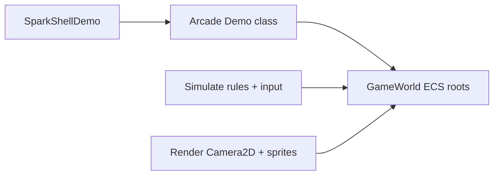

# Arcade demos — complete games in one module

SparkDemo **#11–#13** are **self-contained arcade loops** — no `.sparkscene`, no external level files. Each game lives in a tight **`.hpp` + `.cpp` pair** registered in `DemoCatalog.cpp`, loaded by `SparkShellDemo` through `Load` / `Unload` / `Simulate` / `Render`.

They are the fastest way to learn “whole game in code” before Parts **8–9** product paths.

| # | Hotkey | Class | Lines of focus |
|---|--------|-------|----------------|
| **11** | **T** | `Tetris2DDemo` | Falling tetrominoes, line clear, tilemap well |
| **12** | **C** | `Connect3Demo` | Match-3 grid, swap, combo FX |
| **13** | **I** | `SpaceInvaders2DDemo` | Alien grid, player shot, wave motion |

**Catalog:** [SparkDemo catalog](10-sparkdemo-catalog.md) · **2D submit:** [2D render pipeline](../2-2d-graphics/06-2d-render-pipeline.md).

## Shared architecture



| Piece | Role |
|-------|------|
| `DemoRootCollection roots` | Track spawned objects; `DestroyAll` in `Unload` |
| Procedural atlas | `Make*Tetris*Atlas` / `MakeGemAtlas` when bundled art missing |
| `Camera2D` + `Submit*` | Orthographic playfield fit to window |
| `HelpHud` / `TextOverlay` | Score, status, control hints |
| `DemoAudio` / procedural SFX | No WAV dependency for core feedback |
| `VfxSubsystem::Queue` | Line clears, match flashes, explosions |

Unlike `Platformer2DDemo` (**#6**), arcade modules **do not** own a full `Game` subclass — the shell calls into the demo struct. Your standalone game can wrap the same logic in `IGame` when you graduate from the launcher.

---

## Concept: lifecycle hooks (all three games)

#### C++

```cpp
void Tetris2DDemo::Load(GameWorld& w, IEngineContext& context) {
    roots.Clear();
    atlasTex = Detail::MakeTetrisBlockAtlas();
    w.Assets().RegisterTexture(atlasTex, "spark/tetris/blocks");
    // board tilemap, HUD, help overlay ...
}

void Tetris2DDemo::Unload(GameWorld& w) {
    helpHud.Unmount(w);
    roots.DestroyAll(w);
}

void Tetris2DDemo::Simulate(const FrameTiming& timing, IEngineContext& context, GameWorld& world) {
    DemoHelpHud::ProcessGlobalToggle(context.GetInput());
    // input → grid logic → audio/VFX
    helpHud.Update(timing, context);
}

void Tetris2DDemo::Render(Scene& scene, GameWorld& world, IEngineContext& context) {
    // Camera2D + standard 2D scene submit + helpHud.PatchSceneRenderParams
}
```

#### C\#

```csharp
// Arcade sources are C++; port by subclassing Game and moving Load/Simulate bodies into OnAttach/OnUpdate.
```

#### Python

```python
pass
```

---

## Mini-part A — Tetris (**#11 / T**)

**Source:** `src/spark/demo/Tetris2DDemo.cpp` · `Tetris2DDemo.hpp`

### Game model

| State | Implementation |
|-------|----------------|
| Well | `TilemapComponent` 10×22, `kTileWorld = 1` |
| Active piece | Integer grid + `Detail::kPieceCells` rotation tables |
| Ghost / pad | Extra `SpriteComponent` roots for preview and frame |
| Randomizer | Inline LCG in demo class (`RandU32`) |

Rules live in **plain methods** (`Fits`, `TryMove`, `LockPiece`, `ClearLines`, `PushBoardToTilemap`) — not a separate rules DLL.

### Controls (from help string)

| Key | Action |
|-----|--------|
| Arrows | Move / soft drop |
| Up / X | Rotate CW |
| Space | Hard drop |
| R | Restart after game over |

### Concept: sync logic grid → tilemap

#### C++

```cpp
void Tetris2DDemo::PushBoardToTilemap() {
    // For each cell in wellGrid, write GID into TilemapComponent layer 0
    tilemap->SetTile(0, x, y, tileId);
}
```

Call after lock and line clear so rendering reflects simulation.

#### C\#

```csharp
// Tilemap.SetTile from your grid array.
```

#### Python

```python
# tilemap_component.set_tile when interop exposes layer writes.
```

**Takeaway:** one authoritative **integer grid**; ECS tilemap is the view.

---

## Mini-part B — Match-3 (**#12 / C**)

**Source:** `src/spark/demo/Connect3Demo.cpp`

### Game model

| State | Implementation |
|-------|----------------|
| Board | `TilemapComponent` 8×8 gem IDs |
| Selection | Two-cell swap + validity check |
| Match scan | Row/column runs of ≥3 |
| Presentation | `BlendModeComponent` glow sprites + additive flash |

Procedural `MakeGemAtlas()` fills the atlas if no artist PNG is wired — same “demo ships alone” pattern as Tetris.

### Audio

Match events call `DemoPlayProceduralClip` with `DemoSfx::ClipMatch3Swap/Clear/Combo` — see [Sound clips](../6-sound/02-clips.md).

### Concept: pick cell from screen

Match-3 converts pointer / keyboard cursor to **grid indices**, then animates swap in `Simulate` before committing tile IDs.

#### C++

```cpp
// After mapping screen → world with Camera2D:
const int gx = static_cast<int>(std::floor(localX / kTileWorld));
const int gy = static_cast<int>(std::floor(localY / kTileWorld));
```

#### C\#

```csharp
// Use Camera2D.ScreenToWorld from bindings when available.
```

#### Python

```python
pass
```

**Takeaway:** turn-based **grid mutation** with short tween state in the demo struct (`pendingSwap`, `comboLevel` fields).

---

## Mini-part C — Space Invaders (**#13 / I**)

**Source:** `src/spark/demo/SpaceInvaders2DDemo.cpp`

### Game model

| State | Implementation |
|-------|----------------|
| Aliens | Fixed array of structs `{ go, tr, spr, alive, gi, gj }` |
| Motion | Group translation + edge bounce in `Simulate` |
| Player | Sprite + clamped X, cooldown fire |
| Shots | Pooled or spawned bullet sprites, AABB vs alien |
| Art | `DemoAssets::TryLoadSpaceShooterShips` or procedural atlas fallback |

Bundled Kenney-style sheets override procedural UVs when `assets/` paths resolve — [Assets pipeline](12-assets-and-content-pipeline.md).

### Concept: destroy alien entity

#### C++

```cpp
if (hit) {
    world.DestroyGameObject(aliens[i].go);
    aliens[i].alive = false;
    DemoPlayProceduralClip(context, DemoSfx::ClipExplosion(), 0.9F);
}
```

Track roots in `DemoRootCollection` only for objects that must survive level reload.

#### C\#

```csharp
World.DestroyGameObject(alien);
```

#### Python

```python
world.destroy_game_object(alien)
```

**Takeaway:** **struct-of-arrays** style gameplay state + ECS for drawables — good template for bullet-hell prototypes.

---

## Porting arcade code to your game

| Arcade pattern | Product game equivalent |
|----------------|-------------------------|
| `Load` / `Unload` | `OnAttach` / `OnDetach` |
| `Simulate` | `OnUpdate` after `Game::OnUpdate` |
| `Render` | `OnRender` + `SubmitStandardLitSceneFromWorld` or 2D submit |
| `roots.DestroyAll` | Scene unload or `SceneManager` swap |
| Procedural atlas | Replace with `RegisterTexture` from content pipeline |

When the loop grows past ~800 lines, split **rules** (`TetrisRules.hpp`) from **presentation** — but keep one scene file until you need editor-authored levels ([Part 8](../8-2d-game/00-2d-game-systems-map.md)).

---

## Suggested study order

1. **Tetris** — grid + tilemap sync, discrete timestep via `FrameTiming`.  
2. **Match-3** — pointer picking, combo chains, blend modes.  
3. **Space Invaders** — entity arrays, shooting, destruction, HUD.

Then compare with **#6** platformer (full gameplay kit) and **F** P0 path (scenes + save).

Next: [Part 2 — Sprites](../2-2d-graphics/01-sprites.md) · [Glossary & roadmaps](16-glossary-and-roadmap-hub.md).
