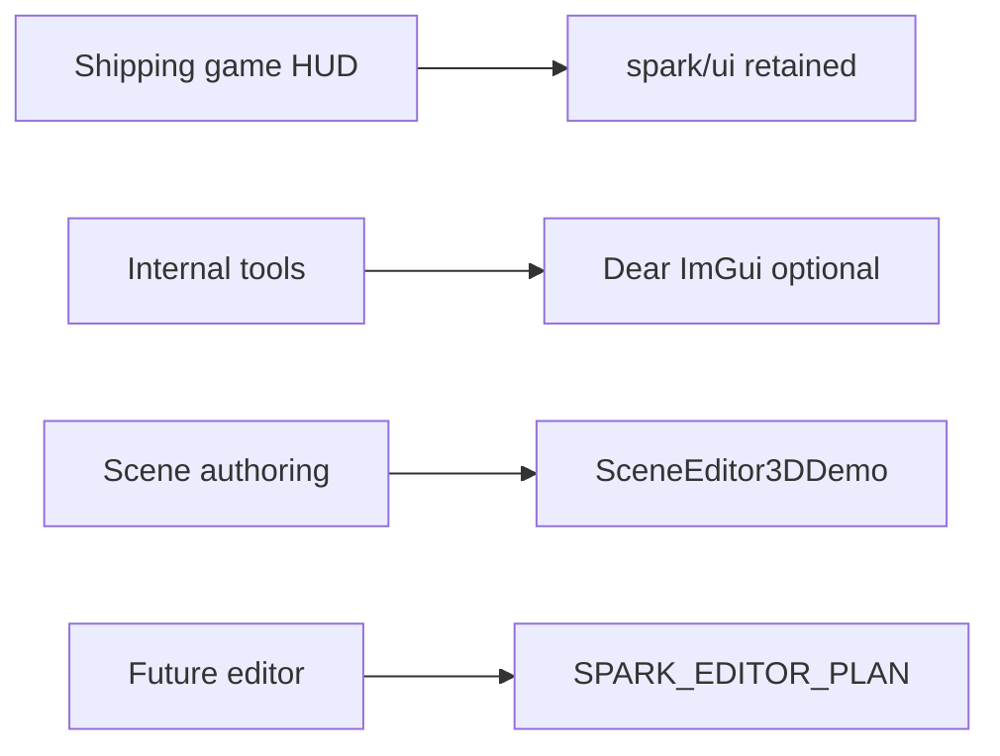

# Part 10 — Tools and in-engine workflows

Spark ships **authoring prototypes** inside SparkDemo — not a separate executable editor product yet. Part 10 maps demos **#10**, **#20**, and **#24** to APIs you reuse in tools and game menus.

**UI foundations:** [UI and toolkits](../1-overview-architecture/08-ui-and-toolkits.md) · **Demos:** [SparkDemo catalog](../1-overview-architecture/10-sparkdemo-catalog.md).

## When to use what

| Need | Tool path | Demo |
|------|-----------|------|
| Place meshes/lights, save `.sparkscene` | Retained UI + scene editor | **#10** Scene editor |
| Docking inspectors, fast iteration | Dear ImGui | **#20** (key **G**) |
| Long-term editor product direction | `SparkEditorDemo` prototype | **#24** (key **E**) |
| In-game pause menu | `UiCanvasComponent` + Spark native factory | [UI chapter](../1-overview-architecture/08-ui-and-toolkits.md) |
| Debug overlay only | `DemoHelpHud` / ImGui window | [Debugging](../1-overview-architecture/14-debugging-and-diagnostics.md) |

## Chapters

| Ch. | Guide | Focus |
|-----|--------|--------|
| [01](01-scene-editor-3d.md) | Scene editor 3D | Gizmo, picking, save/load, asset browser |
| [02](02-dear-imgui-and-tool-ui.md) | Dear ImGui showcase | Docking, when ImGui vs retained UI |
| [03](03-spark-editor-direction.md) | Spark editor demo | Roadmap pointer, do not duplicate full plan |

## Build flags

| CMake option | Effect |
|--------------|--------|
| `SPARK_ENABLE_IMGUI=ON` (default) | ImGui + Vulkan backend, demo **#20** |
| `SPARK_ENABLE_IMGUI=OFF` | `TryGetImGuiLayer()` null; retained UI only |

## Not covered here (see roadmaps)

- Full **tilemap** editor: [Tilemap editor roadmap](../2-2d-graphics/04-tilemap-editor-roadmap.md)  
- **GUI** productization: [`GUI_EDITOR_ROADMAP.md`](../../GUI_EDITOR_ROADMAP.md)  
- **Vulkan** internals: [`ARCHITECTURE_AND_DEVELOPER_GUIDE.md`](../../ARCHITECTURE_AND_DEVELOPER_GUIDE.md)

Next: [Scene editor 3D](01-scene-editor-3d.md).
