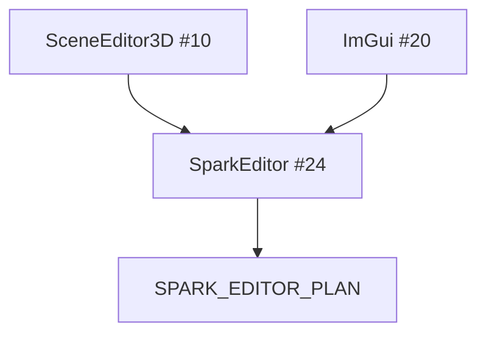

# Spark editor demo and product direction (#24)

`SparkEditorDemo` (**#24 / key E**) is a **thin product prototype** — layout chrome, asset hooks, and editor loop experiments. It is not a replacement for **#10** Scene editor today.

**Authoritative plan:** [`SPARK_EDITOR_PLAN.md`](../../SPARK_EDITOR_PLAN.md) (do not duplicate milestone tables here).

## How demos relate



| Demo | Maturity | Role |
|------|----------|------|
| **#10** | Usable slice | Save scenes, place entities, play preview |
| **#20** | Toolkit sample | ImGui docking patterns for tools |
| **#24** | Directional | UX experiments feeding the editor plan |
| **#22** Model viewer | Inspection | glTF/material review without editing |

## What to copy into your pipeline now

1. **Scene serialization** from **#10** — `.sparkscene` + `SceneManager`.  
2. **Asset catalog refresh** — same pump as [Assets pipeline](../1-overview-architecture/12-assets-and-content-pipeline.md).  
3. **Help + diagnostics** — `DemoHelpHud`, [Debugging](../1-overview-architecture/14-debugging-and-diagnostics.md).  
4. **Tilemap authoring** — programmatic + future editor APIs ([Tilemap roadmap](../2-2d-graphics/04-tilemap-editor-roadmap.md)).

## Concept: launch editor demo

#### C++

```bash
./build/SparkDemo
# TAB to list · select Spark editor row · or press E when bound
```

Inspect `SparkEditorDemo.cpp` for which subsystems are wired (UI backend, scene bootstrap, tool panels).

#### C\#

```csharp
// Future: SparkEditor as standalone host — see SPARK_EDITOR_PLAN.
```

#### Python

```python
pass
```

## Reading order for contributors

1. [Scene editor 3D](01-scene-editor-3d.md) — concrete APIs.  
2. [`SPARK_EDITOR_PLAN.md`](../../SPARK_EDITOR_PLAN.md) — milestones and non-goals.  
3. [`GUI_EDITOR_ROADMAP.md`](../../GUI_EDITOR_ROADMAP.md) — UI panels in editor.  
4. [`SCENE_AND_RENDERING_GAPS.md`](../../SCENE_AND_RENDERING_GAPS.md) — rendering features blocked on tooling.

Part 10 complete → [Glossary & roadmap hub](../1-overview-architecture/16-glossary-and-roadmap-hub.md) · [Part 7 components](../7-game-components-usage/00-introduction.md).
