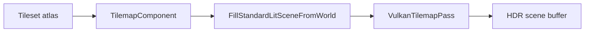

# Tilemaps

Spark tilemaps are **multi-layer grids** backed by a shared **`Tileset`** (atlas + per-tile `TileDefinition`). They render in the **tilemap Vulkan pass** with per-layer sort offsets, world-Y sort, flip/rotate, tint, and animated clips. Collision and pathfinding read the same definitions through companion components.

**Try it:** SparkDemo **#19 — Tilemap layers, animation & pathfinding** (`TilemapShowcase2DDemo`).

**Ship a full level:** step-by-step TMX → grid → collision → spawns — [Tilemap level authoring](08-tilemap-level-authoring.md).

## Rendering path



Sprites and tilemaps share the **16-layer** `sceneTextures` table — pack tilesets and sprite atlases deliberately.

## Coordinate system

| Space | Convention |
|-------|------------|
| World | +X right, +Y up (`Camera2D`) |
| Grid cell `(x, y)` | Origin **bottom-left** of the map |
| TMX import | CSV rows flipped so Tiled's top row → high `y` in Spark |

Object markers from TMX convert Tiled pixel `y` to Spark `cellY` when parsing `objectgroup` layers.

## Core types

- `Tileset` — texture + `TileDefinition` per id (collision, path flags, animation index).
- `TilemapComponent` — width, height, `tileWorldSize`, layers, sparse cell storage.
- `TileCell` — display tile id, paint id, flip bits, per-cell tint.

## Concept: create a layered map

### C++

```cpp
#include "spark/ecs/components/rendering/TilemapComponent.hpp"
#include "spark/scene/tilemap/Tileset.hpp"

SharedPtr<Tileset> tileset = CreateTilesetFromAtlas(atlas, atlasCols, atlasRows);
tileset->Definition(wallTileId).collisionShape = TileCollisionShape::FullCell;
tileset->Definition(wallTileId).flags = TileDefinitionFlags::BlocksPathfinding;
tileset->Definition(floorTileId).collisionShape = TileCollisionShape::None;

GameObject* mapGo = world.CreateGameObject();
TilemapComponent* tilemap = mapGo->AddComponent<TilemapComponent>(
    tileset, mapW, mapH, 1.0F, /*sortOrderBase=*/0);
static_cast<void>(tilemap->AddLayer("Terrain"));
tilemap->SetPaintTile(0, x, y, grassPaintId);
tilemap->SetTileCell(0, x, y, TileCell::FromTileId(floorTileId));
```

### C\#

```csharp
var mapGo = world.CreateGameObject("Level");
var tilemap = mapGo.AddTilemap(tilesetHandle, mapW, mapH, tileWorldSize: 1f, sortOrderBase: 0);
tilemap.AddLayer("Terrain");
tilemap.SetPaintTile(0, x, y, grassPaintId);
tilemap.SetTileCell(0, x, y, TileCell.FromTileId(floorTileId));
```

### Python

```python
map_go = world.create_game_object("Level")
tilemap = map_go.add_tilemap("tilesets/dungeon", map_w, map_h, tile_world_size=1.0, sort_order_base=0)
tilemap.add_layer("Terrain")
tilemap.set_paint_tile(0, x, y, grass_paint_id)
```

(Exact Python method names follow generated `TilemapComponent` wrappers in `spark-python` for your engine build.)

## Concept: stacked layers

| Layer role | Typical settings |
|------------|------------------|
| Terrain | `contributeCollision=true`, `contributeGameplayGrid=true` |
| Water | animated tiles, `sortMode=WorldY` |
| Props | `contributeGameplayGrid=false`, higher `orderInLayerOffset` |

### C++

```cpp
TilemapLayer& props = tilemap->GetLayer(2);
props.orderInLayerOffset = 16;
props.contributeGameplayGrid = false;
props.sortMode = TilemapLayerSortMode::WorldY;
```

### C\#

```csharp
var props = tilemap.GetLayer(2);
props.OrderInLayerOffset = 16;
props.ContributeGameplayGrid = false;
props.SortMode = TilemapLayerSortMode.WorldY;
```

### Python

```python
props = tilemap.get_layer(2)
props.set_order_in_layer_offset(16)
props.set_contribute_gameplay_grid(False)
```

Companion components:

- `TilemapTileAnimatorComponent` — clip time for animated tiles.
- `TilemapAutotileComponent` — terrain autotile from paint layer.
- `TilemapCollider2DComponent` — static physics from definitions.

## Concept: gameplay grid and pathfinding

### C++

```cpp
#include "spark/ecs/components/tilemap/TilemapGameplayGridComponent.hpp"

TilemapGameplayGridComponent* grid = mapGo->AddComponent<TilemapGameplayGridComponent>();
grid->SetWalkRule(TilemapGameplayWalkRule::DefinitionAndFlags);
grid->SetAutoRebake(true);
grid->RequestRebake();
grid->RebakeIfNeeded(*mapGo);

const TilemapGridFrame& frame = grid->GetGridFrame();
Vector2 world = frame.CellCenterToWorldXY({cellX, cellY});
```

### C\#

```csharp
var grid = mapGo.AddTilemapGameplayGrid();
grid.SetWalkRule(TilemapGameplayWalkRule.DefinitionAndFlags);
grid.SetAutoRebake(true);
grid.RequestRebake();
grid.RebakeIfNeeded(mapGo);
var center = grid.GetGridFrame().CellCenterToWorldXY(new GridCell(cellX, cellY));
```

### Python

```python
grid = map_go.add_tilemap_gameplay_grid()
grid.set_walk_rule_definition_and_flags()
grid.set_auto_rebake(True)
grid.request_rebake()
```

See [Pathfinding](../4-ai/05-pathfinding.md) for `GridPathfinder::FindPath4`.

## Concept: TMX / `.sparkmap` import

### C++

```cpp
#include "spark/ecs/components/tilemap/TilemapMapSourceComponent.hpp"

TilemapMapSourceComponent* source = mapGo->AddComponent<TilemapMapSourceComponent>();
source->SetImportOnAttach(false);
source->SetTmxPath("sprites/kenney_tiny-dungeon/Tiled/sampleMap.tmx");
source->SetPixelsPerWorldUnit(16.0F);
source->SetHotReload(true);
source->ImportNow(*mapGo, world);
```

`ApplyTilemapDocument` loads textures via `GameWorld::LoadTexture`, applies Kenney packed-atlas fixes, and derives `tileWorldSize` from PPU when the document leaves size at zero.

### C\#

```csharp
var source = mapGo.AddTilemapMapSource();
source.SetTmxPath("sprites/kenney_tiny-dungeon/Tiled/sampleMap.tmx");
source.SetPixelsPerWorldUnit(16f);
source.ImportNow(mapGo, world);
```

### Python

```python
source = map_go.add_tilemap_map_source()
source.set_tmx_path("sprites/kenney_tiny-dungeon/Tiled/sampleMap.tmx")
source.set_pixels_per_world_unit(16.0)
source.import_now()
```

## Concept: object layers (spawns, chests)

### C++

```cpp
TilemapObjectLayerComponent* objects = mapGo->AddComponent<TilemapObjectLayerComponent>();
const std::uint32_t li = objects->AddObjectLayer("GameplayObjects");

TilemapObjectMarker chest{};
chest.typeId = Utf8String("chest");
chest.cellX = 10;
chest.cellY = 6;
static_cast<void>(objects->AddMarker(li, chest));

mapGo->AddComponent<TilemapObjectSpawnComponent>();
```

### C\#

```csharp
var objects = mapGo.AddTilemapObjectLayer();
uint layer = objects.AddObjectLayer("GameplayObjects");
objects.AddMarker(layer, new TilemapObjectMarker { TypeId = "chest", CellX = 10, CellY = 6 });
mapGo.AddTilemapObjectSpawn();
```

### Python

```python
objects = map_go.add_tilemap_object_layer()
layer = objects.add_object_layer("GameplayObjects")
objects.add_marker(layer, type_id="chest", cell_x=10, cell_y=6)
```

## Screen → cell picking (2D)

Use **`TerrainScreenToWorldRay`** (`spark/demo/ShellDemoSceneUtil.hpp`) with `Camera2D::ViewProjection` — **no extra `1 - y` flip**.

### C++

```cpp
Matrix4 invVp{};
camera.ViewProjection(fbW, fbH).TryInvert(invVp);
Vector3 ro{}, rd{};
TerrainScreenToWorldRay(fbW, fbH, mx, my, invVp, ro, rd);
const float t = -ro.z / rd.z;
const Vector2 world{ro.x + rd.x * t, ro.y + rd.y * t};
GridPathfinder::Cell cell = grid->GetGridFrame().WorldXYToCell(world);
```

### C\#

```csharp
var invVp = viewProj.Invert();
TerrainScreenToWorldRay(fbW, fbH, mx, my, invVp, out var ro, out var rd);
float t = -ro.Z / rd.Z;
var world = new Vector2(ro.X + rd.X * t, ro.Y + rd.Y * t);
var cell = grid.GetGridFrame().WorldXYToCell(world);
```

### Python

```python
# Prefer engine picking helpers when exposed; otherwise mirror invVp unproject in native demo code.
cell = grid.get_grid_frame().world_xy_to_cell(world_x, world_y)
```

## Collision pairing

`TilemapCollider2DComponent` bakes per-tile shapes from `TileDefinition` (full cell, half cell, convex). Decor tiles should use `TileCollisionShape::None`.

**Editor / tools:** `TilemapDocumentCapturer`, `TilemapPicker`, `TilemapEditSession` — `spark/scene/tilemap/TilemapServices.hpp`, [Tilemap editor roadmap](04-tilemap-editor-roadmap.md), and [level authoring](08-tilemap-level-authoring.md).

Gameplay walkthrough: [2D gameplay API guide](../8-2d-game/09-2d-gameplay-api-guide.md).

Next: [2D Animation](04-2d-animation.md) · **Level authoring:** [08-tilemap-level-authoring](08-tilemap-level-authoring.md).
