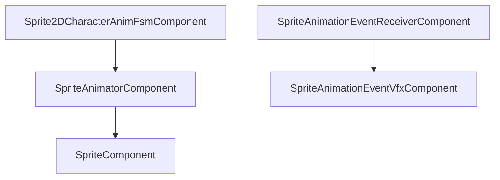

# 2D Animation

2D animation in Spark spans **UV-based sprite sheets**, **`SpriteAnimatorComponent`** clips, **FSM-driven character states**, **animation events**, **2D hitboxes**, and juice on `TransformComponent`. Update priorities matter: FSM (100) → animator (200) → event receiver (215) → camera rig (300).

## Pipeline



## Concept: manual sprite sheet stepping

Use for prototypes or cutscenes without clip assets.

### C++

```cpp
struct AnimFrame { Vector4 uv; float duration; };

void TickSpriteAnim(const FrameTiming& timing, SpriteComponent* sprite,
                    const Array<AnimFrame>& loop, int& frame, float& accum) {
    accum += timing.deltaTimeSeconds;
    if (accum >= loop[frame].duration) {
        accum = 0.0F;
        frame = (frame + 1) % static_cast<int>(loop.GetSize());
        sprite->SetUvRect(loop[frame].uv);
    }
}
```

### C\#

```csharp
void TickSpriteAnim(float dt, SpriteComponent sprite, AnimFrame[] loop, ref int frame, ref float accum) {
    accum += dt;
    if (accum >= loop[frame].Duration) {
        accum = 0f;
        frame = (frame + 1) % loop.Length;
        sprite.SetUvRect(loop[frame].Uv);
    }
}
```

### Python

```python
def tick_sprite_anim(dt: float, sprite, loop: list, frame: list, accum: list) -> None:
    accum[0] += dt
    if accum[0] >= loop[frame[0]].duration:
        accum[0] = 0.0
        frame[0] = (frame[0] + 1) % len(loop)
        sprite.set_uv_rect(loop[frame[0]].uv)
```

## Concept: `SpriteAnimatorComponent`

Grid-atlas clips with optional crossfade (`spark/ecs/components/animation/SpriteAnimatorComponent.hpp`).

### C++

```cpp
go->AddComponent<SpriteComponent>(texture, tint, fullUv, sortOrder);
SpriteAnimatorComponent* sa = go->AddComponent<SpriteAnimatorComponent>();
sa->SetUniformGrid(4, 4);
SpriteAnimationClip run{};
run.firstFrame = 4;
run.frameCount = 8;
run.framesPerSecond = 10.0F;
run.loop = true;
sa->AddClip(run);
sa->SetClipIndex(0);
```

### C\#

```csharp
go.AddSprite(texKey, tint, uv, sortOrder);
var sa = go.AddSpriteAnimator();
sa.SetUniformGrid(4, 4);
var run = new SpriteAnimationClip {
    FirstFrame = 4, FrameCount = 8, FramesPerSecond = 10f, Loop = true
};
sa.AddClip(run);
sa.SetClipIndex(0);
```

### Python

```python
go.add_sprite(tex_key, tint, uv, sort_order=100)
anim = go.add_sprite_animator()
anim.set_uniform_grid(4, 4)
anim.add_clip(first_frame=4, frame_count=8, fps=10.0, loop=True)
anim.set_clip_index(0)
```

## Concept: character locomotion FSM

Add **before** `SpriteAnimatorComponent` on the same object (priority 100 vs 200).

### C++

```cpp
go->AddComponent<Sprite2DCharacterAnimFsmComponent>();
go->AddComponent<SpriteAnimatorComponent>();
Sprite2DCharacterAnimFsmComponent* fsm = go->GetComponent<Sprite2DCharacterAnimFsmComponent>();
fsm->RequestAttack();
fsm->RequestHurt();
```

Reads `Rigidbody2D` velocity when present; can consume `AiAgentComponent` combat commands.

### C\#

```csharp
go.AddSprite2DCharacterAnimFsm();
go.AddSpriteAnimator();
go.GetComponent<Sprite2DCharacterAnimFsm>()?.RequestAttack();
```

### Python

```python
go.add_sprite_2d_character_anim_fsm()
go.add_sprite_animator()
go.get_component_sprite_2d_character_anim_fsm().request_attack()
```

## Concept: animation events (footsteps, VFX)

Markers use **normalized clip time** 0..1. Fires `SignalId::SpriteAnimationEvent`.

### C++

```cpp
SpriteAnimationEventReceiverComponent* recv = go->AddComponent<SpriteAnimationEventReceiverComponent>();
recv->AddMarker(1, 0.25F, "Footstep");
recv->AddMarker(1, 0.75F, "Footstep");

SpriteAnimationEventVfxComponent* vfx = go->AddComponent<SpriteAnimationEventVfxComponent>();
vfx->AddBinding("Footstep", "footstep_puff_2d");
vfx->SetWorldOffset({0.0F, -0.35F, 0.0F});
```

### C\#

```csharp
var recv = go.AddSpriteAnimationEventReceiver();
recv.AddMarker(clipIndex: 1, normalizedTime: 0.25f, eventName: "Footstep");
var vfx = go.AddSpriteAnimationEventVfx();
vfx.AddBinding("Footstep", "footstep_puff_2d");
```

### Python

```python
recv = go.add_sprite_animation_event_receiver()
recv.add_marker(1, 0.25, "Footstep")
vfx = go.add_sprite_animation_event_vfx()
vfx.add_binding("Footstep", "footstep_puff_2d")
```

## Concept: `AnimationHitbox2DComponent`

Frame-synced melee / hurtbox while a clip plays.

### C++

```cpp
AnimationHitbox2DComponent* hit = go->AddComponent<AnimationHitbox2DComponent>();
hit->SetClipIndex(2U);
hit->SetStartLocalFrame(0U);
hit->SetEndLocalFrame(0U);
hit->SetShape(AnimationHitbox2DShape::Arc);
hit->SetRadius(1.0F);
```

### C\#

```csharp
var hit = go.AddAnimationHitbox2D();
hit.SetClipIndex(2);
hit.SetShape(AnimationHitbox2DShape.Arc);
hit.SetRadius(1f);
```

### Python

```python
hit = go.add_animation_hitbox_2d()
hit.set_clip_index(2)
hit.set_shape_arc()
hit.set_radius(1.0)
```

## Concept: flip facing

### C++

```cpp
const bool facingLeft = velocity.x < 0.0F;
tr->SetScale({facingLeft ? -baseScaleX : baseScaleX, baseScaleY, 1.0F});
```

### C\#

```csharp
tr.SetScale(new Vector3(facingLeft ? -baseScaleX : baseScaleX, baseScaleY, 1f));
```

### Python

```python
go.get_or_add_transform().set_scale(Vector3(-abs(sx) if left else abs(sx), sy, 1.0))
```

## Concept: squash and stretch

### C++

```cpp
const float vy = playerRb->GetVelocity().y;
const float stretch = 1.0F + std::clamp(vy * 0.02F, -0.15F, 0.15F);
playerTr->SetScale({baseScaleX / stretch, baseScaleY * stretch, 1.0F});
```

### C\#

```csharp
float stretch = 1f + Math.Clamp(vy * 0.02f, -0.15f, 0.15f);
tr.SetScale(new Vector3(baseScaleX / stretch, baseScaleY * stretch, 1f));
```

### Python

```python
stretch = 1.0 + max(-0.15, min(0.15, vy * 0.02))
tr.set_scale(Vector3(base_sx / stretch, base_sy * stretch, 1.0))
```

## HUD: `TextOverlayComponent`

Screen-space text without a full GUI canvas.

### C++

```cpp
TextOverlayComponent* text = hud->AddComponent<TextOverlayComponent>();
text->SetScreenPosition(12.0F, 12.0F);
text->SetFontSizePixels(20.0F);
text->SetColor({0.94F, 0.97F, 1.0F});
text->SetText(Utf8String("Score: 0"));
```

Requires `world.SetUiFont(font)` — see platformer `MountUiFontIfNeeded`.

### C# / Python

Bind when your scripting layer exposes `TextOverlayComponent`; otherwise mount UI font in native bootstrap and drive scores via mirrored components.

## 3D note

For skeletal clips use `AnimatorComponent` + `AnimationEventReceiverComponent` on 3D characters ([Game Component Reference](../1-overview-architecture/07-game-component-reference.md#animation)).

Next: [2D Lighting](05-2d-lighting.md).
