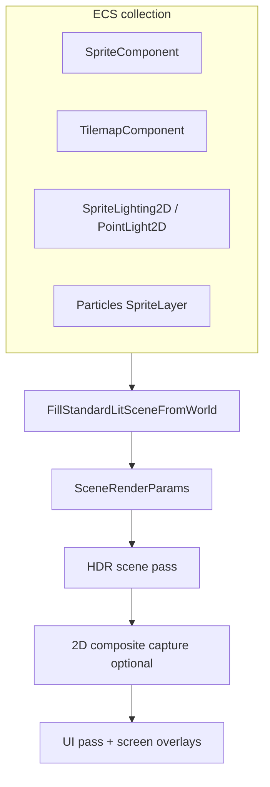

# 2D Render Pipeline

This chapter describes how ECS 2D content becomes GPU work in Spark's **standard lit scene** path. The same `FillStandardLitSceneFromWorld` entry point collects **3D meshes**, **sprites**, **tilemaps**, lights, particles, foliage, water, and UI — but the 2D-specific stages are sprite batching, tilemap chunking, 2D lighting in `sprite.frag`, and optional **2D composite** offscreen passes.

**Reference implementation:** `spark/scene/submit/SceneSubmit.cpp` (`FillStandardLitSceneFromWorld`), `VulkanSpritePass`, `VulkanTilemapPass`, `VulkanScene2DCompositeCapture`.

## Pipeline overview



## `SceneRenderParams` (2D-relevant fields)

| Field | Limit / notes | Purpose |
|-------|----------------|---------|
| `sprites` | 8192 | `SceneSpriteDraw` array |
| `tilemaps` / `tilemapTiles` | budgeted per pass | Layered tile draws |
| `sceneTextures` | **16** layers | Atlases for sprites + tilesets |
| `pointLights` | shared with 3D | Includes `PointLight2DComponent` |
| `spriteSortMode` | enum | Sort policy |
| `viewProjection` | `Matrix4` | From active camera |
| `sceneTimeSeconds` | float | Shader time + sprite FX |
| `screenTexts` / `screenRects` | — | HUD primitives |
| `uiTextures` | separate table | GUI and composite RGBA8 |

```cpp
enum class SceneSpriteSortMode : std::uint8_t {
    SortOrderOnly = 0,
    SortOrderThenWorldY = 1,
};
```

`SortOrderThenWorldY` is the platformer default: primary key `sortOrder`, secondary key world **Y** (bottom of sprite) so co-planar characters sort correctly in side-view games.

## What `FillStandardLitSceneFromWorld` does (2D slice)

On each call the function **clears** prior frame draw lists, resolves directional light + ambient (`SceneLightingResolver`), gathers enabled `PointLightComponent` and `PointLight2DComponent`, then walks active `GameObject`s to append:

- **Sprites** — world matrix, tint, UV rect, sort order, texture layer index.
- **Tilemaps** — per-layer tiles with flip/rotate/tint/clip animation.
- **Text overlays** — world or screen text from `TextOverlayComponent`.
- **Particles** — when `ParticleRenderSpace::SpriteLayer`, sorted with sprites.
- **`Scene2DCompositeViewComponent`** — minimap, fog of war, outline views (captured in a follow-up ortho pass on Vulkan).

It also runs `ProcessTimeOfDayDrivers` and `ApplyRegionalRenderVolumes` before mesh/sprite collection — 2D games often leave these at defaults.

C++ signature (simplified):

```cpp
void FillStandardLitSceneFromWorld(
    GameWorld& world,
    IEngineContext& context,
    const Matrix4& viewProjection,
    const Vector3& cameraPositionWorld,
    const Vector3& lightDirectionWorld,
    const Vector3& lightColor,
    float lightIntensity,
    const Vector3& ambientColor,
    bool enableParticles,
    const Vector3& particleCameraRight,
    const Vector3& particleCameraUp,
    float sceneTimeSeconds,
    SceneRenderParams& params,
    SceneSpriteSortMode spriteSortMode = SceneSpriteSortMode::SortOrderOnly,
    const Scene* sceneForCulling = nullptr);
```

Convenience wrappers (`SubmitStandardLitSceneFromWorld`, `FillStandardLitSceneFromWorldWithCamera`) wire camera components and particle billboards.

## Concept: end-to-end 2D frame

### C++

```cpp
void Platformer2DGame::OnRender(IRenderFrame&, IEngineContext& context) {
    int fbW = 0, fbH = 0;
    context.GetFramebufferSize(fbW, fbH);
    if (fbW <= 0) fbW = 1;
    if (fbH <= 0) fbH = 1;

    const Matrix4 viewProj = camera.ViewProjection(static_cast<float>(fbW), static_cast<float>(fbH));
    Vector3 pr{}, pu{};
    camera.BillboardBasisWorld(pr, pu);

    SubmitStandardLitSceneFromWorld(
        GetWorld(), context, viewProj, camera.position,
        Vector3{0.30F, 0.86F, 0.36F}.Normalized(),
        Vector3{1.0F, 0.98F, 0.95F}, 0.85F,
        Vector3{0.16F, 0.18F, 0.24F},
        false, pr, pu, sceneTimeSeconds,
        SceneSpriteSortMode::SortOrderThenWorldY);
}
```

### C\#

```csharp
public override void OnRender(IRenderFrame frame, IEngineContext context) {
    context.GetFramebufferSize(ref var fbW, ref var fbH);
    fbW = Math.Max(fbW, 1);
    fbH = Math.Max(fbH, 1);

    var viewProj = _camera.ComputeViewProjection(fbW, fbH);
    _camera.BillboardBasisWorld(out var pr, out var pu);

    SceneSubmit.SubmitStandardLitSceneFromWorld(
        World, context, viewProj, _camera.Position,
        _sunDir, _sunColor, 0.85f, _ambient,
        enableParticles: false, pr, pu, _sceneTime,
        SceneSpriteSortMode.SortOrderThenWorldY);
}
```

### Python

Script-hosted games implement `on_render` on `Game` and rely on the engine to call `FillStandardLitSceneFromWorld` after ECS update — you normally **do not** build `SceneRenderParams` manually. Ensure the scene has an active `Camera2DComponent` and sprites/tilemaps on the world you received from `context.try_get_scene()`.

```python
class MyGame(Game):
    def on_render(self, context: EngineContext) -> None:
        # Gameplay already ran in on_update; engine submits the world.
        pass
```

Use C++ or C# `OnRender` overrides when you need custom sun direction, particle enablement, or manual `PaintUiCanvases`.

## Concept: GUI on top of 2D

```cpp
SceneRenderParams params{};
FillStandardLitSceneFromWorld(..., params);
PaintUiCanvases(GetWorld(), params, fbW, fbH);
context.SetSceneRenderParams(params);
```

GUI draws into `screenRects`, `screenSprites`, and font-backed `screenTexts` with paint order — after world sprites unless you use late overlay channels.

### C\#

```csharp
var p = new SceneRenderParams();
FillStandardLitSceneFromWorld(world, context, ..., p);
PaintUiCanvases(world, p, fbW, fbH);
context.SetSceneRenderParams(p);
```

### Python

Prefer toolkit components (`GuiCanvasComponent`, etc.) when bound in your build; otherwise use `TextOverlayComponent` from native-side setup.

## Vulkan: sprite pass internals (conceptual)

1. **Sort** `params.sprites` per `spriteSortMode`.
2. **Batch** consecutive draws with the same pipeline state + texture layer.
3. **Vertex shader** expands unit quad with per-instance model matrix, tint, UV rect.
4. **Fragment shader** (`sprite.frag`) samples atlas; optional branches for `SpriteLighting2DMode` and clustered point lights.

Tilemaps use a separate pass with chunk culling; both passes target the HDR scene color buffer before tonemapping.

## 2D composite capture

When `Scene2DCompositeViewComponent` is present, `VulkanScene2DCompositeCapture` may render orthographic views into `RenderTexture` targets (minimap, fog). The UI pass copies RGBA8 captures into `uiTextures` for widgets. Budgets and size caps: [2D runtime limits](../8-2d-game/08-scene2d-runtime-limits.md).

## Simulation vs render order

Physics and gameplay should finish **before** render submit:

```cpp
void OnUpdate(const FrameTiming& t, IEngineContext& ctx) override {
    // 1. Input → velocity / intent
    // 2. PhysicsSubsystem::Simulate2D(world, t)  // explicit in platformer
    // 3. Rules (respawn, goals)
    Game::OnUpdate(t, ctx);  // component OnUpdate + animation + audio cues
}
```

`SpriteAnimatorComponent` (priority 200) and `Camera2DRigComponent` (300) expect transforms to reflect post-physics positions when `OnUpdate` returns.

## Debugging checklist

| Symptom | Likely cause |
|---------|----------------|
| Nothing draws | Empty `SceneRenderParams` — forgot submit wrapper or `SetSceneRenderParams` |
| Wrong Y sort | `SortOrderOnly` with equal `sortOrder` |
| Pink/black sprites | Texture not in `sceneTextures` table (unregistered key) |
| >16 atlases | Extra unique textures in one frame — atlas merge |
| HUD behind world | GUI not painted or wrong overlay channel |

Next: [Render layers and sorting](07-render-layers-and-sorting.md) (demo **#18**).

Part 2 complete → **Part 3**: [Meshes and Materials](../3-3d-graphics/01-meshes-and-materials.md).
