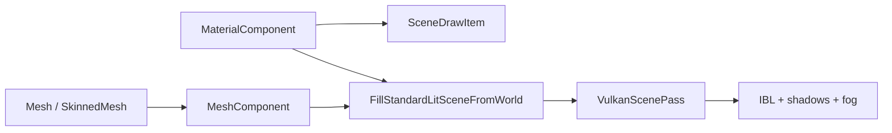

# Meshes and Materials

3D rendering in Spark is **forward-clustered PBR** on Vulkan: opaque and transparent `MeshComponent` draws fill `SceneRenderParams::draws` / `transparentDraws`, skinned meshes use a separate path, and materials feed **push constants** + texture bindings consumed by `pbr.frag` / glTF extension variants.

**Demos:** launcher **#21** `GltfSamples3DDemo` (PBR + IBL), **#22** `ModelViewer3DDemo`, FPS sample procedural cubes.

## Data flow



## Class design: `Mesh`

CPU vertex/index buffers (`spark/scene/mesh/Mesh.hpp`):

```cpp
struct Vertex {
    Vector3 position;
    Vector3 normal;
    Vector2 texCoord;
};

static Mesh CreateUnitCube();
static Mesh CreateGroundPlane(float halfExtent);
static Mesh CreateSkyDome(float radius, int latSegs, int lonSegs);
static bool TryLoadFromObj(const char* path, Mesh& outMesh);
static bool TryLoadFromGltf(const char* path, Mesh& outMesh, SharedPtr<Texture2D>* outBaseColor = nullptr);
```

glTF import runs `Mesh::RecomputeTangentSpace` for normal mapping.

## Class design: `MeshComponent`

```cpp
MeshComponent(SharedPtr<Mesh> mesh, SceneMeshSlot slot, Vector3 albedo);
void SetMesh(SharedPtr<Mesh> m);
void SetMeshSlot(SceneMeshSlot slot);
```

| `SceneMeshSlot` | Use |
|-----------------|-----|
| `UnitCube` | Built-in GPU cube |
| `GroundPlane` | Built-in plane |
| `Custom` | Upload `Mesh` vertices each frame |

Register custom meshes: `world.RegisterMesh(mesh, "fps/unit_cube")`.

## Class design: `MaterialComponent`

```cpp
class MaterialComponent final : public GameComponent {
public:
    MaterialComponent(SharedPtr<Texture2D> baseColor, Vector3 inTint = Vector3::One);
    void SetMetallic(float m);
    void SetRoughness(float r);
    void SetEmissive(const Vector3& rgb, float intensity);
    void SetShadingModel(SceneShadingModel s);  // LitPbr, ToonCel, ...
    SharedPtr<Texture2D> GetNormalTexture() const noexcept;
    SharedPtr<Texture2D> GetMetallicRoughnessTexture() const noexcept;
};
```

`ApplyMaterialComponentToSceneDrawItem()` copies PBR fields into each `SceneDrawItem`. Library assets: `SetMaterialAsset(world, "materials/hero.sparkmat")`.

## Concept: spawn a lit glTF prop

Prefer `GltfAssetBinder::BindFromPath` — mesh, materials, texture keys, skeleton when skinned.

### C++

```cpp
GameObject* go = world.CreateGameObject();
go->AddComponent<TransformComponent>()->SetTranslation({0, 0, 0});
GltfAssetBinder::BindFromPath(*go, "assets/models/DamagedHelmet.glb");
```

Manual path:

```cpp
GltfAsset asset = world.LoadGltf("assets/models/Crate.glb");
GltfAssetBinder::BindRigidMesh(*go, asset, SceneMeshSlot::Custom, Vector3::One, "assets/models/Crate.glb");
if (MaterialComponent* mat = go->GetComponent<MaterialComponent>()) {
    ApplyGltfMaterialDesc(*mat, asset.material);
}
```

### C\#

```csharp
var go = world.CreateGameObject("Helmet");
go.GetOrAddTransform();
GltfAssetBinder.BindFromPath(go, "assets/models/DamagedHelmet.glb");
```

### Python

```python
go = world.create_game_object("Helmet")
go.get_or_add_transform()
go.bind_gltf_from_path("assets/models/DamagedHelmet.glb")
```

(Use generated interop names from your `spark-python` build when `bind_gltf_from_path` differs.)

## Concept: procedural cube (FPS style)

### C++

```cpp
auto unitCube = MakeShared<Mesh>(Mesh::CreateUnitCube());
world.RegisterMesh(unitCube, "fps/unit_cube");

GameObject* target = world.CreateGameObject();
target->AddComponent<TransformComponent>()->SetTranslation({5, 1, -3});
target->AddComponent<MeshComponent>(unitCube, SceneMeshSlot::Custom, Vector3{0.9F, 0.3F, 0.2F});
target->AddComponent<MaterialComponent>(nullptr)->SetRoughness(0.35F);
```

### C\#

```csharp
world.RegisterMesh(unitCube, "fps/unit_cube");
var target = world.CreateGameObject("Target");
target.GetOrAddTransform().SetTranslation(new Vector3(5, 1, -3));
target.AddMesh(SceneMeshSlot.Custom, new Vector3(0.9f, 0.3f, 0.2f));
target.AddMaterial(null).SetRoughness(0.35f);
```

### Python

```python
target = world.create_game_object("Target")
target.get_or_add_transform().set_translation(Vector3(5, 1, -3))
target.add_mesh_custom(albedo=Vector3(0.9, 0.3, 0.2))
target.add_material().set_roughness(0.35)
```

## Multi-material glTF

Multiple material slots → `GltfAssetBinder` + library keys `path.glb#material/N`, or `MultiMaterialComponent` with `SetSlotMaterialAsset`. Variant extension `KHR_materials_variants` cycles via `MultiMaterialComponent` variant index (see demos calling `CycleVariantsOnObjectTree`).

## Material library (`.sparkmat`)

Author under `assets/materials/*.sparkmat` (`sparkmat_v1`). glTF imports also expose `models/Foo.glb#material/0` keys.

### C++

```cpp
material->SetMaterialAsset(world, "materials/hero.sparkmat");
multi->SetSlotMaterialAsset(world, 0, "materials/trim.sparkmat");
```

### C\#

```csharp
mat.SetMaterialAsset(world, "materials/hero.sparkmat");
```

### Python

```python
mat.set_material_asset("materials/hero.sparkmat")
```

## glTF KHR material extensions

Mapped into `MaterialGltfExtensions` and `ModelPushConstants` (`shaders/gltf_pbr_extensions.glsl`):

| Extension | Runtime behavior |
|-----------|-------------------|
| `KHR_materials_clearcoat` | Second specular lobe |
| `KHR_materials_transmission` | Screen-space refract (binding **13**) |
| `KHR_materials_iridescence` | Thin-film specular tint |
| `KHR_materials_variants` | `MultiMaterialComponent` variant index |
| `normalTexture.scale` | `MaterialComponent::GetNormalScale()` |

**IBL:** split-sum specular + **BRDF LUT** (`VulkanIblBrdfLut`, binding **12**). Deep reference: [`GLTF_DISPLAY_ROADMAP.md`](../../../GLTF_DISPLAY_ROADMAP.md), [`MATERIALS_AND_LIGHTING.md`](../../../MATERIALS_AND_LIGHTING.md).

## Transparency and sorting

Transparent draws go to `params.transparentDraws` with distance sort. Water uses `waterDraws` with a dedicated pass. Set material flags / component options when authoring glass (`transmission` extension) or fade props.

## Debugging

| Issue | Check |
|-------|--------|
| Flat grey mesh | Missing `MaterialComponent` or null base color |
| Wrong UVs | Custom mesh tangents; reimport glTF |
| No IBL reflection | HDR environment + BRDF LUT enabled in render init |
| Pink shader | Extension mismatch — verify material variant |

Next: [Cameras in 3D](02-cameras-3d.md).
