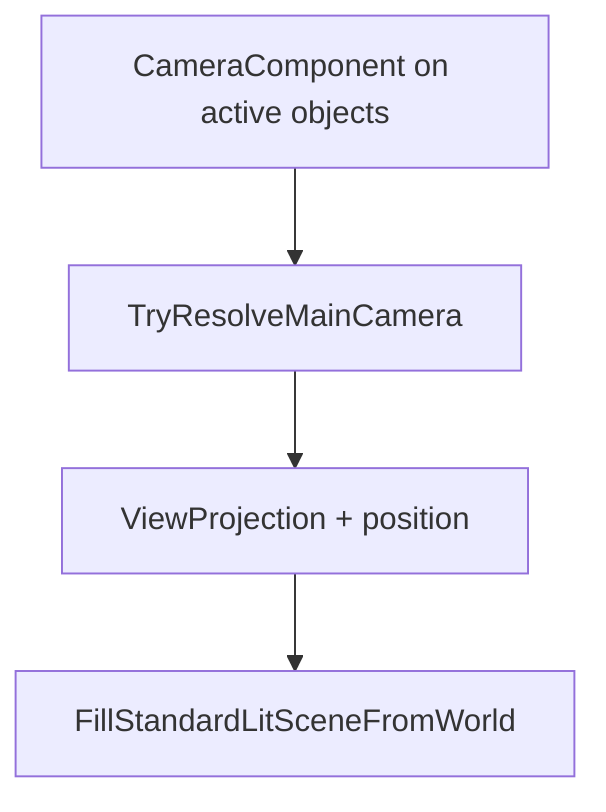

# Cameras in 3D

3D cameras determine **`viewProjection`**, **`cameraPositionWorld`**, and billboard bases passed into `FillStandardLitSceneFromWorld`. Spark supports **ECS `CameraComponent`** (production), **spring-arm third person**, **`FlyCamera`** (demos/FPS), and **`CharacterCameraRig`** helpers.

## Resolution order



Highest **priority** among enabled `CameraComponent` instances wins unless your game passes an explicit matrix (fly camera demos).

## Concept: ECS perspective camera

### C++

```cpp
GameObject* cameraGo = world.CreateGameObject();
CameraComponent* cam = cameraGo->AddComponent<CameraComponent>();
cam->SetProjectionMode(CameraProjectionMode::Perspective);
cam->SetFovYDegrees(72.0F);
cam->SetNearPlane(0.1F);
cam->SetFarPlane(500.0F);
cam->SetPriority(10);
cameraGo->AddComponent<TransformComponent>()->SetTranslation({0, 4, 16});
```

Orthographic: `SetProjectionMode(CameraProjectionMode::Orthographic)` + `SetOrthoHalfHeight`.

### C\#

```csharp
var cameraGo = world.CreateGameObject("MainCamera");
var cam = cameraGo.AddCamera();
cam.SetProjectionMode(CameraProjectionMode.Perspective);
cam.SetFovYDegrees(72f);
cam.SetNearPlane(0.1f);
cam.SetFarPlane(500f);
cam.SetPriority(10);
cameraGo.GetOrAddTransform().SetTranslation(new Vector3(0, 4, 16));
```

### Python

```python
cam_go = world.create_game_object("MainCamera")
cam = cam_go.add_camera()
cam.set_perspective(fov_y_degrees=72.0, near=0.1, far=500.0)
cam.set_priority(10)
cam_go.get_or_add_transform().set_translation(Vector3(0, 4, 16))
```

## Concept: third-person spring arm

Update order: `SpringArm3DComponent` (**295**) → `CameraFollow3DComponent` (**300**).

### C++

```cpp
GameObject* camObj = world.CreateGameObject();
world.SetParent(camObj, player);

SpringArm3DComponent* arm = camObj->AddComponent<SpringArm3DComponent>();
arm->SetPivotTarget(player);
arm->SetArmLength(4.5F);
arm->SetYawRadians(yaw);
arm->SetPitchRadians(-0.25F);

camObj->AddComponent<CameraComponent>();
CameraFollow3DComponent* follow = camObj->AddComponent<CameraFollow3DComponent>();
follow->SetTarget(player);
follow->SetTargetOffset({0.0F, 1.6F, 0.0F});
follow->SetLookAtTarget(true);
```

### C\#

```csharp
var camObj = world.CreateGameObject("FollowCam");
world.SetParent(camObj, player);
var arm = camObj.AddSpringArm3D();
arm.SetPivotTarget(player);
arm.SetArmLength(4.5f);
camObj.AddCamera();
var follow = camObj.AddCameraFollow3D();
follow.SetTarget(player);
follow.SetTargetOffset(new Vector3(0, 1.6f, 0));
follow.SetLookAtTarget(true);
```

### Python

```python
cam_obj = world.create_game_object("FollowCam")
world.set_parent(cam_obj, player)
arm = cam_obj.add_spring_arm_3d()
arm.set_pivot_target(player)
arm.set_arm_length(4.5)
cam_obj.add_camera()
follow = cam_obj.add_camera_follow_3d()
follow.set_target(player)
```

## Concept: `FlyCamera` (FPS demos)

Struct `spark/scene/camera/FlyCamera.hpp` — not a component; your `Game` owns it.

### C++

```cpp
void OnAttach(IEngineContext& context) override {
    context.GetInput().SetCursorCaptured(true);
}

void OnUpdate(const FrameTiming& timing, IEngineContext& context) override {
    IInput& in = context.GetInput();
    if (in.IsCursorCaptured()) {
        camera.AddLook(in.GetMouseDeltaX(), in.GetMouseDeltaY());
        camera.ProcessMovement(in, timing.deltaTimeSeconds);
    }
    Game::OnUpdate(timing, context);
}

void OnRender(IRenderFrame&, IEngineContext& ctx) override {
    int w = 1, h = 1;
    ctx.GetFramebufferSize(w, h);
    const float aspect = static_cast<float>(w) / static_cast<float>(h);
    const Matrix4 vp = Matrix4::PerspectiveVulkan(DegreesToRadians(70.0F), aspect, 0.1F, 500.0F)
                     * camera.ViewMatrix();
    Vector3 camRight{}, camUp{};
    camera.BillboardBasis(camRight, camUp);
    SubmitStandardLitSceneFromWorld(GetWorld(), ctx, vp, camera.position,
        sunDir, sunColor, sunIntensity, ambient,
        true, camRight, camUp, sceneTimeSeconds);
}
```

### C\#

Mirror the FPS template game's `OnUpdate` / `OnRender` with a `FlyCamera` struct wrapper if your C# game embeds the same demo logic.

### Python

Fly camera is typically native-driven in FPS samples; script games use ECS `CameraComponent` unless you expose fly helpers.

## Concept: perspective matrix convention

Spark uses **`PerspectiveVulkan`** (Y flip compatible with framebuffer coordinates). Do not mix OpenGL projection helpers without conversion.

```cpp
const Matrix4 proj = Matrix4::PerspectiveVulkan(DegreesToRadians(72.0F), aspect, 0.1F, 200.0F);
const Matrix4 viewProj = proj * camera.ViewMatrix();
```

ECS alternative:

```cpp
const Matrix4 viewProj = cam->ViewProjection(*cameraGo, aspect);
```

### C\#

```csharp
var vp = cam.ViewProjection(cameraGo, aspect);
```

### Python

```python
vp = cam.compute_view_projection(cam_go, aspect)
```

## `CharacterCameraRig`

Non-ECS orbit with collision pull-in — `CharacterCameraDemo`, header `CharacterCameraRig.hpp`.

## Billboards

`BillboardComponent` (priority **50**) rotates toward the main camera — pickups, VFX quads, impostors.

### C++

```cpp
pickup->AddComponent<BillboardComponent>();
```

### C\#

```csharp
pickup.AddBillboard();
```

### Python

```python
pickup.add_billboard()
```

See [Game Component Reference](../1-overview-architecture/07-game-component-reference.md#camera).

Next: [Lighting](03-lighting.md).
