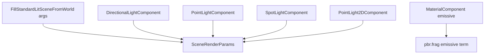

# Lighting

Lighting in Spark is **hybrid**: a directional sun + ambient hemisphere in `SceneRenderParams`, punctual lights from ECS components, emissive materials, IBL for specular, optional time-of-day drivers, and regional volumes. `FillStandardLitSceneFromWorld` calls `SceneLightingResolver::Resolve` then merges component lights.

## Light sources map



| Component | GPU representation |
|-----------|-------------------|
| `PointLightComponent` | `ScenePointLight` (shadow optional) |
| `SpotLightComponent` | `SceneSpotLight` (cone, shadow optional) |
| `DirectionalLightComponent` | Overrides sun on submit |
| `PointLight2DComponent` | Same point array, no shadows |
| Submit args | Default sun direction/color/intensity/ambient |

Caps: `SceneRenderParams::MaxPointLights` / `MaxSpotLights` — excess lights are skipped silently.

## Concept: point and spot lights

Spot local **−Z** is the beam axis.

### C++

```cpp
#include "spark/ecs/components/lighting/PointLightComponent.hpp"
#include "spark/ecs/components/lighting/SpotLightComponent.hpp"

GameObject* lamp = world.CreateGameObject();
lamp->AddComponent<TransformComponent>()->SetTranslation({3, 2, 0});
PointLightComponent* pl = lamp->AddComponent<PointLightComponent>();
pl->SetColor({1.0F, 0.85F, 0.6F});
pl->SetIntensity(4.0F);
pl->SetRange(12.0F);
pl->SetCastsShadow(true);

GameObject* spotGo = world.CreateGameObject();
TransformComponent* str = spotGo->AddComponent<TransformComponent>();
str->SetTranslation({0, 4, 0});
str->SetRotationEuler({DegreesToRadians(-45.0F), 0, 0});
SpotLightComponent* sl = spotGo->AddComponent<SpotLightComponent>();
sl->SetColor({0.9F, 0.95F, 1.0F});
sl->SetIntensity(6.0F);
sl->SetRange(18.0F);
sl->SetInnerConeDegrees(12.0F);
sl->SetOuterConeDegrees(28.0F);
sl->SetCastsShadow(true);
```

### C\#

```csharp
var lamp = world.CreateGameObject("Lamp");
lamp.GetOrAddTransform().SetTranslation(new Vector3(3, 2, 0));
var pl = lamp.AddPointLight();
pl.SetColor(new Vector3(1f, 0.85f, 0.6f));
pl.SetIntensity(4f);
pl.SetRange(12f);
pl.SetCastsShadow(true);

var spotGo = world.CreateGameObject("Spot");
spotGo.GetOrAddTransform().SetTranslation(new Vector3(0, 4, 0));
var sl = spotGo.AddSpotLight();
sl.SetIntensity(6f);
sl.SetOuterConeDegrees(28f);
sl.SetCastsShadow(true);
```

### Python

```python
lamp = world.create_game_object("Lamp")
lamp.get_or_add_transform().set_translation(Vector3(3, 2, 0))
pl = lamp.add_point_light()
pl.set_color(Vector3(1.0, 0.85, 0.6))
pl.set_intensity(4.0)
pl.set_range(12.0)
pl.set_casts_shadow(True)
```

## Concept: submit a complete lit scene

### C++

```cpp
void OnRender(IRenderFrame&, IEngineContext& ctx) override {
    SubmitStandardLitSceneFromWorldWithCamera(
        GetWorld(), ctx,
        Vector3{0.25F, -1.0F, 0.15F}.Normalized(),
        Vector3{1.0F, 0.97F, 0.92F},
        3.5F,
        Vector3{0.12F, 0.14F, 0.20F},
        true,
        sceneTime);
}
```

Manual fly camera:

```cpp
SubmitStandardLitSceneFromWorld(
    GetWorld(), ctx, vp, camera.position,
    sunDir, sunColor, 3.5F, ambient,
    true, camRight, camUp, sceneTime);
```

### C\#

```csharp
SceneSubmit.SubmitStandardLitSceneFromWorldWithCamera(
    World, ctx, SunDir, SunColor, 3.5f, Ambient,
    enableParticles: true, sceneTime);
```

### Python

```python
# Engine template calls submit after on_update; set DirectionalLightComponent on scene root if exposed.
pass
```

## Concept: emissive materials

Local glow without a light entity — affects bloom and exposure, not punctual shadow maps.

### C++

```cpp
MaterialComponent* mat = prop->GetComponent<MaterialComponent>();
mat->SetEmissive({0.2F, 0.9F, 1.0F}, 2.5F);
```

### C\#

```csharp
mat.SetEmissive(new Vector3(0.2f, 0.9f, 1f), 2.5f);
```

### Python

```python
mat.set_emissive(Vector3(0.2, 0.9, 1.0), 2.5)
```

## IBL and image-based specular

Outdoor profiles enable HDR environment radiance + prefiltered specular + BRDF LUT. glTF metals rely on this path — ensure demo scenes load IBL assets (`ThreeDDemo`, `GltfSamples3DDemo`).

## Time of day

`ProcessTimeOfDayDrivers` inside `FillStandardLitSceneFromWorld` adjusts sun when `SceneRenderParams::useTimeOfDay` is set (`TimeOfDayDemo`, `WaterLakeDemo`).

### C++

```cpp
params.useTimeOfDay = true;
params.timeOfDay = 0.35F;  // normalized 0..1
```

### C\#

```csharp
p.UseTimeOfDay = true;
p.TimeOfDay = 0.35f;
```

### Python

```python
# Set via native scene driver components when authoring time-of-day in script layers.
```

## Regional volumes

`ApplyRegionalRenderVolumes` tints fog/exposure by camera position — useful for caves and interior cells without separate scenes. Components and recipes: [Post-process, fog, volumes](10-post-process-fog-volumes.md) (**demo #17**).

Further reading: [`MATERIALS_AND_LIGHTING.md`](../../../MATERIALS_AND_LIGHTING.md), [Shadows](04-shadows.md).

Next: [Shadows](04-shadows.md).
