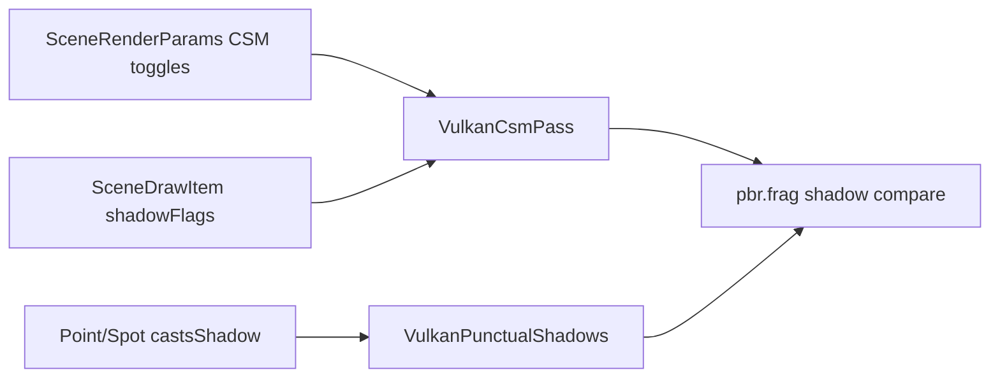

# Shadows

Spark implements **cascaded shadow maps (CSM)** for the directional sun and optional **cubemap / spotlight shadow atlases** for punctual lights. Shadow flags flow from `SceneRenderParams` defaults → per-material overrides → per-draw rules in `FillStandardLitSceneFromWorld`.

## Shadow pipeline



## Concept: shadow-enabled scene

### C++

```cpp
SceneRenderParams params{};
params.lightingProfile = SceneLightingProfile::Outdoor;
params.directionalShadowsEnabled = true;
params.punctualShadowsEnabled = true;

FillStandardLitSceneFromWorld(
    world, context, viewProj, cameraPos,
    Vector3{0.3F, -1.0F, 0.2F}.Normalized(),
    Vector3{1.0F, 0.98F, 0.95F}, 1.4F,
    Vector3{0.14F, 0.16F, 0.22F},
    true, {}, {}, sceneTime, params);

PointLightComponent* pl = lamp->AddComponent<PointLightComponent>();
pl->SetCastsShadow(true);
```

`SubmitStandardLitSceneFromWorld` wrappers set the same fields when using lighting presets.

### C\#

```csharp
var p = new SceneRenderParams {
    LightingProfile = SceneLightingProfile.Outdoor,
    DirectionalShadowsEnabled = true,
    PunctualShadowsEnabled = true
};
FillStandardLitSceneFromWorld(world, ctx, vp, camPos, sunDir, sunColor, 1.4f, ambient,
    enableParticles: true, pr, pu, sceneTime, p);
lamp.GetComponent<PointLightComponent>()?.SetCastsShadow(true);
```

### Python

```python
lamp = world.create_game_object("Lamp")
pl = lamp.add_point_light()
pl.set_casts_shadow(True)
# Directional/CSM flags come from the native game's OnRender / lighting profile.
```

## Directional CSM (`SceneRenderParams`)

| Field | Default | Role |
|-------|---------|------|
| `directionalShadowsEnabled` | `true` | Master CSM toggle |
| `shadowCascadeNear` / `shadowCascadeFar` | `0` | `0` = lighting preset |
| `shadowBias` | `0.0026` | Depth compare bias |
| `shadowNormalBias` | `0.048` | Grazing surface bias |
| `shadowDistanceMax` | `0` | Fade distance (`0` = preset) |
| `useTimeOfDay` | preset | Sun direction before CSM build |

Large outdoor scenes (`WaterLakeDemo`): `shadowCascadeFar = 1200`.

### C++

```cpp
params.shadowCascadeFar = 900.0F;
params.shadowBias = 0.0026F;
params.shadowNormalBias = 0.048F;
```

### C\#

```csharp
p.ShadowCascadeFar = 900f;
p.ShadowBias = 0.0026f;
```

### Python

```python
# Tune via native demo params or custom OnRender in C++ host for script games.
```

## Per-material and per-draw flags

`SceneDrawItem::shadowFlags` uses `kSceneShadowCast` / `kSceneShadowReceive`.

### C++

```cpp
MaterialComponent* mat = seabed->AddComponent<MaterialComponent>();
mat->SetShadowCastOverride(false);
mat->SetShadowReceiveOverride(true);
mat->ClearShadowCastOverride();
```

Built-in submit rules (when not overridden):

| Draw | Cast |
|------|------|
| `TerrainComponent` | Always casts |
| Low `GroundPlane` / submerged cubes | Often no cast |
| `SkyComponent` | Neither cast nor receive |
| Water (`WaterBodyComponent`) | Receive-only via `ResolveWaterShadowFlags` |

### C\#

```csharp
mat.SetShadowCastOverride(false);
```

### Python

```python
mat.set_shadow_cast_override(False)
```

## Concept: punctual shadows

### C++

```cpp
pl->SetCastsShadow(true);
sl->SetCastsShadow(true);
```

GPU cost scales with shadow-casting light count — budget in `MaterialShowcase3DDemo` / `TimeOfDayDemo`.

### C\#

```csharp
pl.SetCastsShadow(true);
sl.SetCastsShadow(true);
```

### Python

```python
pl.set_casts_shadow(True)
sl.set_casts_shadow(True)
```

## Toon + shadows

Toon materials still sample shadow terms:

### C++

```cpp
mat->SetShadingModel(SceneShadingModel::ToonCel);
mat->SetToonDiffuseBands(3);
mat->SetToonRimIntensity(0.35F);
```

See `ToonShadingDemo`.

### C# / Python

Same property setters on `MaterialComponent` mirrors.

## Debugging

| Artifact | Tweak |
|----------|--------|
| Peter-panning | Raise `shadowBias` |
| Acne | Raise `shadowNormalBias` |
| Huge terrain shadow slab | Raise `shadowCascadeFar`; disable cast on submerged props |
| Cascade shimmer | Profile `cascadeBlendFraction` |

CSM UV outside cascade tiles → fully lit in `scene.frag` (avoids false shadows at frustum edges).

Next: [Skinned Characters](05-skinned-characters.md).
