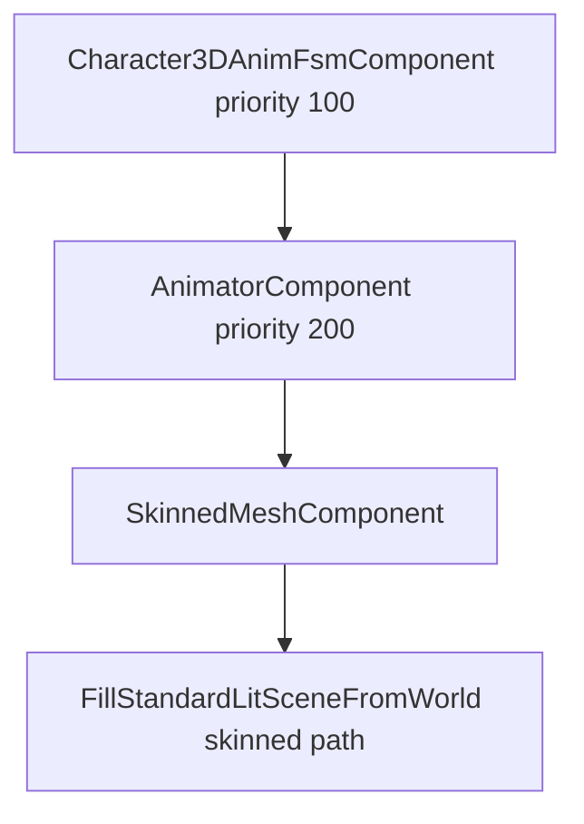

# Skinned Characters

Skinned rendering combines **`SkinnedMeshComponent`**, **`AnimatorComponent`** (joint palette), **`Skeleton`**, and optional **`Character3DAnimFsmComponent`**. Assets load through `GameWorld::LoadSkinnedGltf`; `GltfAssetBinder::BindFromPath` can attach skinned content automatically when the file contains a skeleton.

## Playback stack



## Asset types

```cpp
struct SkinnedGltfAsset {
    SharedPtr<SkinnedMesh> mesh;
    SharedPtr<Skeleton> skeleton;
    SharedPtr<Texture2D> baseColorTexture;
    std::uint32_t walkClipIndex = 0;
    Quaternion bindUpAlignment;
    float bindFacingYawOffset = 0.0F;
};
```

| Asset | Notes |
|-------|-------|
| `assets/models/Fox.glb` | Walk/Run clips; quadruped IK tests |
| `assets/models/CesiumMan.glb` | Humanoid baseline |

Clip tables: [`docs/ANIMATION_SAMPLE_ASSETS.md`](../../../ANIMATION_SAMPLE_ASSETS.md).

## Concept: spawn animated character

### C++

```cpp
SkinnedGltfAsset fox = world.LoadSkinnedGltf("assets/models/Fox.glb");

GameObject* go = world.CreateGameObject();
go->AddComponent<TransformComponent>()->SetTranslation({0, 0, 0});

go->AddComponent<SkinnedMeshComponent>(fox.mesh);
MaterialComponent* mat = go->AddComponent<MaterialComponent>(fox.baseColorTexture);
mat->SetRoughness(0.6F);

Character3DAnimFsmComponent* fsm = go->AddComponent<Character3DAnimFsmComponent>();
AnimatorComponent* anim = go->AddComponent<AnimatorComponent>(fox.skeleton, fox.walkClipIndex);
anim->SetLoopMode(AnimLoopMode::Loop);
fsm->ConfigureLocomotionFromSkeleton(*fox.skeleton, fox.walkClipIndex);
```

Component order on the object does not matter — stable sort by `UpdatePriority` ensures FSM before animator.

### C\#

```csharp
var fox = world.LoadSkinnedGltf("assets/models/Fox.glb");
var go = world.CreateGameObject("Fox");
go.GetOrAddTransform();
go.AddSkinnedMesh(fox.Mesh);
go.AddMaterial(fox.BaseColorTexture).SetRoughness(0.6f);
var fsm = go.AddCharacter3DAnimFsm();
var anim = go.AddAnimator(fox.Skeleton, fox.WalkClipIndex);
anim.SetLoopMode(AnimLoopMode.Loop);
fsm.ConfigureLocomotionFromSkeleton(fox.Skeleton, fox.WalkClipIndex);
```

### Python

```python
go = world.create_game_object("Fox")
go.bind_skinned_gltf_from_path("assets/models/Fox.glb")
fsm = go.get_component_character_3d_anim_fsm()
anim = go.get_component_animator()
anim.set_loop_mode_loop()
```

## Concept: clip control

### C++

```cpp
anim->SetClipIndex(runClipIndex);
anim->SetPlaybackSpeed(1.2F);
anim->SetNormalizedTime(0.0F);
```

### C\#

```csharp
anim.SetClipIndex(runClipIndex);
anim.SetPlaybackSpeed(1.2f);
```

### Python

```python
anim.set_clip_index(run_clip_index)
anim.set_playback_speed(1.2)
```

## Concept: animation events (3D)

`AnimationEventReceiverComponent` fires `SignalId::AnimationEvent` at normalized clip times — pair with `AnimationEventVfxComponent` for footstep dust.

### C++

```cpp
AnimationEventReceiverComponent* recv = go->AddComponent<AnimationEventReceiverComponent>();
recv->AddMarker(0, 0.5F, "Footstep");
AnimationEventVfxComponent* vfx = go->AddComponent<AnimationEventVfxComponent>();
vfx->AddBinding("Footstep", "impact");
```

### C\#

```csharp
go.AddAnimationEventReceiver().AddMarker(0, 0.5f, "Footstep");
go.AddAnimationEventVfx().AddBinding("Footstep", "impact");
```

### Python

```python
go.add_animation_event_receiver().add_marker(0, 0.5, "Footstep")
```

## IK and attachment (overview)

Demos use foot IK solvers and weapon sockets on skeleton joints — see `CharacterCameraDemo`, Fox IK tests in native sources. Attachment points are joint indices on `Skeleton` resolved at runtime.

## Submit requirements

Skinned draws are collected when `enableParticles`/mesh paths run inside `FillStandardLitSceneFromWorld` — always submit with the same camera as opaque meshes. Normal maps and glTF materials use the same `MaterialComponent` path as rigid meshes.

Next: [Terrain and Sky](06-terrain-and-sky.md).
