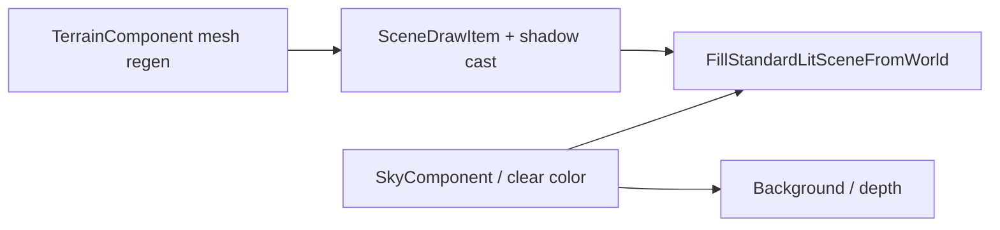

# Terrain and Sky

Outdoor scenes combine **heightfield `TerrainComponent`**, optional **`SkyComponent`** / sky dome meshes, **foliage batches**, and **water bodies**. `SceneRenderParams::worldClearColor` can fake a horizon without geometry (`TerrainDemo`).

## Terrain in the frame



## Class design: `TerrainComponent`

```cpp
explicit TerrainComponent(TerrainGeneratorSettings settings, Vector3 meshAlbedo = ...);

void ResetHeightsToProcedural(GameObject& owner);
void RegenerateMesh(GameObject& owner);
bool TryRaycastWorld(const GameObject& owner, Vector3 rayOriginWorld,
                     Vector3 rayDirWorld, float maxDistance, Vector3& outHitWorld) const;
void ApplyHeightBrushWorld(GameObject& owner, Vector3 centerWorld,
                           float radiusWorld, float deltaY);
```

Terrain **always casts** directional shadows unless material overrides block it.

## Concept: procedural terrain (`TerrainDemo` #4)

### C++

```cpp
#include "spark/ecs/components/rendering/TerrainComponent.hpp"
#include "spark/scene/mesh/TerrainGeneratorSettings.hpp"

TerrainGeneratorSettings ts{};
ts.subdivX = 288;
ts.subdivZ = 288;
ts.halfExtentX = 220.0F;
ts.halfExtentZ = 220.0F;
ts.heightScale = 26.0F;
ts.noiseScale = 0.0135F;
ts.octaves = 6;
ts.persistence = 0.5F;
ts.lacunarity = 2.05F;
ts.seed = 0xC047ACEEu;
ts.worldUnitsPerTextureRepeat = ts.halfExtentX * 2.0F;

GameObject* terrainGo = world.CreateGameObject();
terrainGo->AddComponent<TransformComponent>();
terrainGo->AddComponent<TerrainComponent>(ts);
if (MaterialComponent* m = terrainGo->AddComponent<MaterialComponent>(groundTex)) {
    m->SetMetallic(0.02F);
    m->SetRoughness(0.94F);
}

SceneRenderParams params{};
params.worldClearColorEnabled = true;
params.worldClearColor = {0.42F, 0.62F, 0.92F};
```

Fly camera + LMB/RMB sculpting is implemented in the demo game's `OnUpdate`.

### C\#

```csharp
var ts = new TerrainGeneratorSettings {
    SubdivX = 288, SubdivZ = 288,
    HalfExtentX = 220f, HalfExtentZ = 220f,
    HeightScale = 26f, Seed = 0xC047ACEEu
};
var terrainGo = world.CreateGameObject("Terrain");
terrainGo.AddTerrain(ts);
terrainGo.AddMaterial(groundTex).SetRoughness(0.94f);
```

### Python

```python
terrain_go = world.create_game_object("Terrain")
terrain_go.add_terrain(subdiv_x=288, subdiv_z=288, half_extent_x=220.0, height_scale=26.0)
terrain_go.add_material(ground_key).set_roughness(0.94)
```

## Concept: height brush (runtime edit)

### C++

```cpp
TerrainComponent* terrain = terrainGo->GetComponent<TerrainComponent>();
terrain->ApplyHeightBrushWorld(*terrainGo, brushCenterWorld, radius, deltaY);
terrain->RegenerateMesh(*terrainGo);
```

### C\#

```csharp
terrain.ApplyHeightBrushWorld(terrainGo, center, radius, deltaY);
terrain.RegenerateMesh(terrainGo);
```

### Python

```python
terrain.apply_height_brush_world(terrain_go, center, radius, delta_y)
terrain.regenerate_mesh(terrain_go)
```

Scripting may expose sculpt via `TerrainSculptController` in spark-sharp templates.

## Sky options

| Approach | When |
|----------|------|
| `worldClearColor` only | Simple demos, uniform horizon |
| `SkyComponent` + procedural gradient | Time of day |
| `Mesh::CreateSkyDome` + emissive material | Artist-authored skydome texture |
| IBL HDR environment | PBR outdoor (`GltfSamples3DDemo`) |

### C++

```cpp
go->AddComponent<SkyComponent>()->SetSunDirection(sunDir);
```

### C\#

```csharp
go.AddSky().SetSunDirection(sunDir);
```

### Python

```python
go.add_sky().set_sun_direction(sun_dir)
```

## Foliage and grass

`FoliageBatchComponent` / wind demos (`FoliageWindDemo`, `GrassFieldTerrainDemo`) instance cards on terrain — collected into `params.foliageBatches` during submit. Extended stack: [Environment stack](09-environment-stack.md).

## Water pairing

`WaterBodyComponent` draws via `waterDraws` with receive-only shadows. Large `shadowCascadeFar` keeps shoreline CSM stable (`WaterLakeDemo`).

## Picking / locomotion

`TryRaycastWorld` supports camera grounding and brush placement. Screen rays use the same Vulkan projection conventions as [Cameras in 3D](02-cameras-3d.md).

Next: [Particles](07-particles.md).
