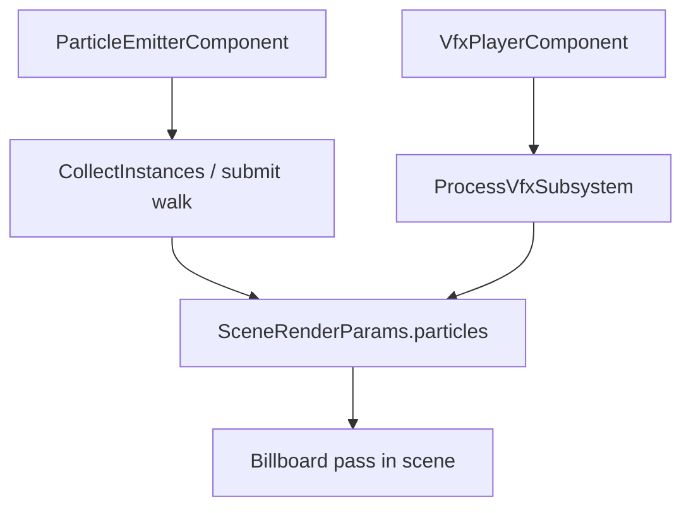

# Particles

Particles are **CPU-simulated billboards** collected into `SceneRenderParams::particles` (and optionally drawn on the **2D sprite layer** when `ParticleRenderSpace::SpriteLayer`). Sources: `ParticleEmitterComponent`, `VfxPlayerComponent`, `VfxLibrary` builtins, and world `VfxSubsystem` queues.

## Collection path



Requires `enableParticles = true` on `SubmitStandardLitSceneFromWorld*` and a valid camera billboard basis (`camRight`, `camUp`) for world-space quads.

## Class design: `ParticleEmitterComponent`

```cpp
void SetEmissionRate(float rate) noexcept;
void SetLifetime(float minSec, float maxSec) noexcept;
void SetStartEndSize(float start, float end) noexcept;
void SetStartEndColor(const Vector4& start, const Vector4& end) noexcept;
void SetGravity(const Vector3& g) noexcept;
void SetEmissionDirection(const Vector3& dir) noexcept;
void SetUseLocalEmission(bool local) noexcept;
void SetRenderSpace(ParticleRenderSpace space);
void Burst(GameObject& owner, std::uint32_t count);
```

Emission origin = owner `TransformComponent` world translation. `SetUseLocalEmission(true)` rotates direction with the entity.

## Concept: builtin fire preset

### C++

```cpp
#include "spark/scene/vfx/VfxLibrary.hpp"

GameObject* fxGo = world.CreateGameObject();
fxGo->AddComponent<TransformComponent>()->SetTranslation({0, 1, 0});
ParticleEmitterComponent* emitter = fxGo->AddComponent<ParticleEmitterComponent>();
VfxLibrary::ApplyBuiltin(VfxBuiltinId::Fire, *emitter);
```

### C\#

```csharp
var fxGo = world.CreateGameObject("Fire");
fxGo.GetOrAddTransform().SetTranslation(new Vector3(0, 1, 0));
var emitter = fxGo.AddParticleEmitter();
VfxLibrary.ApplyBuiltin(VfxBuiltinId.Fire, emitter);
```

### Python

```python
fx = world.create_game_object("Fire")
fx.get_or_add_transform().set_translation(Vector3(0, 1, 0))
emitter = fx.add_particle_emitter()
emitter.apply_builtin_fire()
```

## Concept: one-shot explosion

### C++

```cpp
VfxLibrary::ApplyBuiltin(VfxBuiltinId::Explosion, *emitter);
emitter->Burst(*fxGo, 96);
```

### C\#

```csharp
VfxLibrary.ApplyBuiltin(VfxBuiltinId.Explosion, emitter);
emitter.Burst(fxGo, 96);
```

### Python

```python
emitter.apply_builtin_explosion()
emitter.burst(96)
```

## Concept: `VfxPlayerComponent` + `.sparkvfx`

### C++

```cpp
VfxPlayerComponent* player = fxGo->AddComponent<VfxPlayerComponent>();
player->SetVfxAssetKey("vfx/explosion");
player->PlayOnce(*fxGo);

world.GetVfxSubsystem().Queue("explosion", hitPosition);
```

Asset format (`sparkvfx_v1`):

```text
builtin explosion
burst 112
```

### C\#

```csharp
fxGo.AddVfxPlayer().SetVfxAssetKey("vfx/explosion").PlayOnce(fxGo);
Native.spark_vfx_play(world, "explosion", hitX, hitY, hitZ);
Native.spark_world_process_vfx(world);
```

### Python

```python
fx.add_vfx_player().set_vfx_asset_key("vfx/explosion").play_once()
```

## Concept: enable in render submit

### C++

```cpp
SubmitStandardLitSceneFromWorldWithCamera(
    world, context, sunDir, sunColor, intensity, ambient,
    true,   // enableParticles
    sceneTime);
```

### C\#

```csharp
SceneSubmit.SubmitStandardLitSceneFromWorldWithCamera(
    world, ctx, sunDir, sunColor, intensity, ambient,
    enableParticles: true, sceneTime);
```

### Python

Particle submit is handled by the native game loop when the template enables VFX processing.

## Concept: 2D sprite-layer particles

For platformers, match sprite sort domain:

### C++

```cpp
emitter->SetRenderSpace(ParticleRenderSpace::SpriteLayer);
emitter->SetEffectKey("coin_pop_2d");
```

See [2D Lighting](../2-2d-graphics/05-2d-lighting.md).

### C\#

```csharp
emitter.SetRenderSpace(ParticleRenderSpace.SpriteLayer);
```

### Python

```python
emitter.set_render_space_sprite_layer()
```

## Curves and modules (advanced)

```cpp
emitter->SetEmissionModuleId("ring");
emitter->SetRingRadius(0.6F);
ParticleFloatCurve sizeCurve{};
sizeCurve.SetEndpoints(0.2F, 0.02F);
emitter->SetSizeCurve(sizeCurve);
```

`VfxShowcaseDemo` (**#3**) lists **30+** builtins and composite effects — see `VfxShowcaseDetail.hpp`.

## `SceneParticleInstance` (GPU instance)

```cpp
struct SceneParticleInstance {
    Vector3 position{};
    float size = 0.1F;
    Vector4 color{1, 1, 1, 1};
    Vector4 uvRect{0, 0, 1, 1};
    std::int32_t textureLayer = -1;
};
```

Next: [VFX and `.sparkvfx`](08-vfx-and-sparkvfx.md) → [Environment stack](09-environment-stack.md) → [Post-process & volumes](10-post-process-fog-volumes.md).
