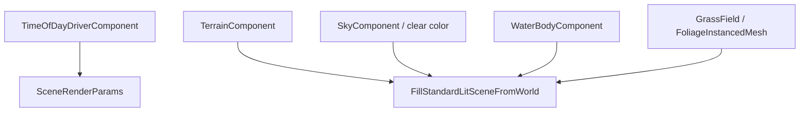

# 3D environment stack

Outdoor and open-world scenes stack **terrain**, **sky / IBL**, **water**, **foliage**, and optional **time-of-day** drivers. SparkDemo covers each vertical slice:

| Demo | Key | Focus |
|------|-----|--------|
| `TerrainDemo` | **#4** | Heightfield sculpt, fly camera, clear color |
| `SkyDemo` | **#2** | Sky box / dome / HDR equirect |
| `TimeOfDayDemo` | **#17 / N** | Sun cycle, fog + post volumes ([ch.10](10-post-process-fog-volumes.md)) |
| `WaterLakeDemo` | **#23 / W** | Island terrain + infinite ocean, SSR, waves |
| `FoliageWindDemo` | **#27 / G** | Wind-driven instanced foliage |
| `GrassFieldTerrainDemo` | **#28 / H** | Terrain-scattered grass chunks |

Primitives: [Terrain and sky](06-terrain-and-sky.md) · [Lighting](03-lighting.md) · **Part 7:** [3D rendering](../7-game-components-usage/02-3d-rendering.md).

## Frame flow



Collect happens in one **`SubmitStandardLitSceneFromWorld`** call; water and terrain participate in shadow cascades when enabled ([Shadows](04-shadows.md)).

---

## Concept: terrain island (game level ground)

Pair **`TerrainComponent`** with PBR ground material. `WaterLakeDemo` builds a smaller island inside an ocean.

### C++

```cpp
#include "spark/ecs/components/rendering/TerrainComponent.hpp"
#include "spark/scene/mesh/TerrainGeneratorSettings.hpp"

TerrainGeneratorSettings ts{};
ts.subdivX = 128;
ts.subdivZ = 128;
ts.halfExtentX = 48.0F;
ts.halfExtentZ = 48.0F;
ts.heightScale = 12.0F;
ts.noiseScale = 0.02F;
ts.seed = 0x1234ABCDu;

GameObject* island = world.CreateGameObject("Island");
island->AddComponent<TransformComponent>();
island->AddComponent<TerrainComponent>(ts);
island->AddComponent<MaterialComponent>(groundTex)->SetRoughness(0.9F);
```

Raycast / sculpt: `TryRaycastWorld`, `ApplyHeightBrushWorld`, `RegenerateMesh` — see [Terrain and sky](06-terrain-and-sky.md).

### C\#

```csharp
island.AddTerrain(ts);
island.AddMaterial(groundTex).SetRoughness(0.9f);
```

### Python

```python
island.add_terrain(subdiv_x=128, subdiv_z=128, half_extent_x=48.0, height_scale=12.0)
```

---

## Concept: sky and IBL background

| Mode | Component / API |
|------|-----------------|
| Flat horizon | `SceneRenderParams::worldClearColor` |
| Procedural gradient | `SkyComponent` + time of day |
| Artist HDR | `Mesh::CreateSkySphere` + HDR texture (`WaterLakeDemo`) |
| PBR specular | IBL from `SceneLightingProfile::Outdoor` + HDR env |

### C++

```cpp
#include "spark/ecs/components/rendering/SkyComponent.hpp"

GameObject* sky = world.CreateGameObject("Sky");
sky->AddComponent<TransformComponent>();
sky->AddComponent<SkyComponent>(SceneSkyMode::Dome);
sky->AddComponent<MeshComponent>(skyMesh, SceneMeshSlot::Custom, Vector3::One);
mat->SetBaseColorTexture(hdrEquirect);
```

### C\#

```csharp
sky.AddSky(SceneSkyMode.Dome);
sky.AddMesh(SceneMeshSlot.Custom, Vector3.One, skyMeshKey);
```

### Python

```python
sky.add_sky(SceneSkyMode.Dome)
```

Load HDR from `assets/textures/sky/` when bundled; demos fall back to flat tint if missing.

---

## Concept: infinite ocean + lake shoreline (`WaterLakeDemo`)

`WaterBodyComponent` supports **finite lake** and **`WaterBodyMode::InfiniteOcean`** with tiled mesh, wave presets, foam, and optional SSR.

### C++

```cpp
#include "spark/ecs/components/water/WaterBodyComponent.hpp"
#include "spark/scene/water/WaterBodyMode.hpp"

WaterSurfaceMeshSettings meshSettings{};
meshSettings.SetSubdivisionsPerAxis(96);
meshSettings.SetTileHalfExtent(128.0F);

auto* water = world.CreateGameObject("Ocean");
water->AddComponent<TransformComponent>();
water->AddComponent<WaterBodyComponent>(
    WaterBodyMode::InfiniteOcean,
    0.0F,  // sea level Y
    WaterBodyExtent::MakeInfinitePlaceholder(),
    WaterWavePresetId::CalmLake,
    meshSettings,
    Vector3{0.04F, 0.36F, 0.52F});

WaterBodyComponent* body = water->GetComponent<WaterBodyComponent>();
body->SetWaveAmplitudeScale(1.28F);
body->SetWaveSpeedScale(1.85F);
body->SetSwellTravelDirectionWorld({-0.78F, -0.63F});
body->SetFoamStrength(0.62F);

WaterScreenSpaceReflectionSettings ssr{};
ssr.SetStrength(0.72F);
body->SetSsrSettings(ssr);
```

**Shadow tip:** raise `shadowCascadeFar` in submit args so shoreline CSM stays stable across large water tiles.

### C\#

```csharp
water.AddWaterBody(WaterBodyMode.InfiniteOcean, seaLevelY: 0f, ...);
water.GetComponent<WaterBodyComponent>()?.SetWaveAmplitudeScale(1.28f);
```

### Python

```python
water.get_or_add_default_component(ComponentKind.WaterBody)
```

Tune live: demo **#23** keys for wave preset, time scale, fly camera.

---

## Concept: time-of-day driver (sun only)

`TimeOfDayDriverComponent` writes normalized time into `SceneRenderParams` before lighting resolve — pairs with outdoor profile sun arc.

### C++

```cpp
#include "spark/ecs/components/world/TimeOfDayDriverComponent.hpp"

GameObject* driver = world.CreateGameObject("TimeOfDay");
auto* tod = driver->AddComponent<TimeOfDayDriverComponent>();
tod->SetDayLengthSeconds(120.0F);
tod->SetTimeOfDay(0.35F);
tod->SetLooping(true);
```

Or set manually each frame:

```cpp
params.useTimeOfDay = true;
params.timeOfDay = normalized0to1;
```

### C\#

```csharp
driver.AddTimeOfDayDriver().SetDayLengthSeconds(120f).SetTimeOfDay(0.35f);
```

### Python

```python
driver.get_or_add_default_component(ComponentKind.TimeOfDayDriver)
```

Full fog/post pairing: [Post-process, fog, volumes](10-post-process-fog-volumes.md) (**demo #17**).

---

## Concept: foliage wind (`FoliageWindDemo` **#27**)

Instanced cards on terrain with wind UBO — `FoliageInstancedMeshComponent` rebuilds instance cache when transforms change.

### C++

```cpp
#include "spark/ecs/components/foliage/FoliageInstancedMeshComponent.hpp"

meadow->AddComponent<FoliageInstancedMeshComponent>();
// Assign mesh/material, scatter transforms; demo rebuilds GPU instances each frame with wind phase.
```

### C\#

```csharp
meadow.AddFoliageInstancedMesh();
```

### Python

```python
meadow.get_or_add_default_component(ComponentKind.FoliageInstancedMesh)
```

---

## Concept: grass field on terrain (`GrassFieldTerrainDemo` **#28**)

Chunked grass scattered on heightfield with slope culling and streaming policy.

### C++

```cpp
#include "spark/ecs/components/foliage/GrassFieldComponent.hpp"

GameObject* grass = world.CreateGameObject("GrassField");
auto* field = grass->AddComponent<GrassFieldComponent>();
field->SetTerrainObject(terrainGo);
field->GetBounds().SetHalfExtentsMeters(40.0F, 40.0F);
// Before submit: field->PrepareForRender(*grass, cameraPosition, maxInstancesPerFrame);
```

### C\#

```csharp
grass.AddGrassField().SetTerrainObject(terrain);
```

### Python

```python
grass.get_or_add_default_component(ComponentKind.GrassField)
```

Attach grass to the **same** terrain used for player raycasts so blades follow sculpted height.

---

## Level assembly checklist

| Step | System |
|------|--------|
| 1 | Terrain or ground mesh + collision if needed |
| 2 | Sky / IBL + `worldClearColor` fallback |
| 3 | Directional light or time-of-day driver |
| 4 | Water body at sea level if coastal |
| 5 | Grass/foliage on terrain bounds |
| 6 | Fog / post volumes for mood ([ch.10](10-post-process-fog-volumes.md)) |
| 7 | Submit with outdoor profile + adequate `shadowCascadeFar` |

---

## Performance notes

| System | Budget awareness |
|--------|------------------|
| Terrain | `subdivX/Z` cost — lower for background hills |
| Water | SSR steps/distance trade GPU for reflection quality |
| Grass | Chunk streaming — shrink bounds while prototyping |
| Foliage | Instance count vs overdraw in wind demo |

External: [Water roadmap](../../WATER_ROADMAP.md), [Foliage roadmap](../../FOLIAGE_ROADMAP.md).

Next: [Post-process, fog, and volumes](10-post-process-fog-volumes.md).
