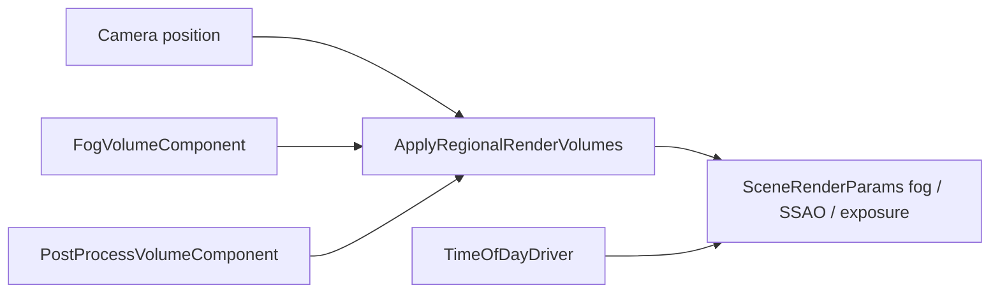

# Post-process, fog, and volumes

Regional **fog** and **post-process** overrides blend into `SceneRenderParams` based on camera position. SparkDemo **#17 — Time of day** (`TimeOfDayDemo`) is the reference: animated sun, `FogVolumeComponent`, `PostProcessVolumeComponent`, CSM shadows, and fly camera.

Also used in **`WaterLakeDemo` (#23)** for exposure/SSAO toggles.

Related: [Lighting — regional volumes](03-lighting.md#regional-volumes) · [Environment stack](09-environment-stack.md) · [Shadows](04-shadows.md).

## How volumes apply



During `FillStandardLitSceneFromWorld`:

1. `ProcessTimeOfDayDrivers` updates `useTimeOfDay` / `timeOfDay`.  
2. `CollectRegionalFogVolumes` / post volumes merge by **priority** and **shape**.  
3. Tonemap pass reads merged fog and exposure.

Volumes use **world-space** `TransformComponent` + `VolumeShape::Box` half-extents (see `VolumeRegions.hpp`).

---

## Concept: time-of-day cycle (`TimeOfDayDemo`)

### C++

```cpp
#include "spark/ecs/components/world/TimeOfDayDriverComponent.hpp"

GameObject* driverGo = world.CreateGameObject("TodDriver");
TimeOfDayDriverComponent* timeDriver = driverGo->AddComponent<TimeOfDayDriverComponent>();
timeDriver->SetDayLengthSeconds(90.0F);
timeDriver->SetTimeOfDay(0.32F);
timeDriver->SetLooping(false);

// Each frame in demo (or rely on component processor during submit):
// timeDriver->SetTimeOfDay(wrapped0to1);
```

Lighting resolve uses `SceneLightingProfile::Outdoor` with normalized time to orient sun color/intensity and sky clear tint.

### C\#

```csharp
var driver = world.CreateGameObject("TodDriver");
driver.AddTimeOfDayDriver()
    .SetDayLengthSeconds(90f)
    .SetTimeOfDay(0.32f)
    .SetLooping(false);
```

### Python

```python
driver.get_or_add_default_component(ComponentKind.TimeOfDayDriver)
```

**Demo controls:** Space pause, +/- time speed, **R** dawn snap, **O** toggle SSAO, fly camera.

**Night / dusk:** time &lt; 0.08 or &gt; 0.92 reads as night in demo HUD phases; tune fog density at low sun for readability.

---

## Concept: fog volume

### C++

```cpp
#include "spark/ecs/components/rendering/FogVolumeComponent.hpp"

GameObject* fogGo = world.CreateGameObject("ValleyFog");
fogGo->AddComponent<TransformComponent>()->SetTranslation({0.0F, 2.0F, 0.0F});
FogVolumeComponent* fog = fogGo->AddComponent<FogVolumeComponent>();
fog->SetHalfExtents({14.0F, 5.0F, 14.0F});
fog->SetFogDensity(0.028F);
fog->SetFogColor({0.62F, 0.68F, 0.78F});
fog->SetFogStart(4.0F);
fog->SetFogEnd(64.0F);
fog->SetPriority(0);
```

Higher **priority** wins when overlapping volumes. Disable with `SetEnabled(false)`.

### C\#

```csharp
fog.AddFogVolume()
    .SetHalfExtents(new Vector3(14f, 5f, 14f))
    .SetFogDensity(0.028f)
    .SetFogColor(new Vector3(0.62f, 0.68f, 0.78f));
```

### Python

```python
fog.get_or_add_default_component(ComponentKind.FogVolume)
```

Use boxes to fake **ground mist** in valleys — pair with low sun from time-of-day for silhouette shots.

---

## Concept: post-process volume

Overrides **SSAO**, **exposure**, and optional **ambient scale** when the camera is inside the box.

### C++

```cpp
#include "spark/ecs/components/rendering/PostProcessVolumeComponent.hpp"

GameObject* postGo = world.CreateGameObject("CavePost");
postGo->AddComponent<TransformComponent>()->SetTranslation({0.0F, 2.0F, 0.0F});
PostProcessVolumeComponent* post = postGo->AddComponent<PostProcessVolumeComponent>();
post->SetHalfExtents({10.0F, 4.0F, 10.0F});
post->SetSsaoEnabled(true);
post->SetExposure(1.12F);
post->SetAmbientScale(0.85F);
post->SetPriority(1);
```

Only fields set via `SetSsaoEnabled` / `SetExposure` / `SetAmbientScale` override globals (`Has*Override` flags on component).

### C\#

```csharp
post.AddPostProcessVolume()
    .SetHalfExtents(new Vector3(10f, 4f, 10f))
    .SetSsaoEnabled(true)
    .SetExposure(1.12f);
```

### Python

```python
post.get_or_add_default_component(ComponentKind.PostProcessVolume)
```

`WaterLakeDemo` places a post volume near the lake for tuning without a full time-of-day loop.

---

## Concept: submit with outdoor profile + TOD

### C++

```cpp
void OnRender(IRenderFrame&, IEngineContext& ctx) override {
    SubmitStandardLitSceneFromWorld(
        GetWorld(), ctx, viewProj, camera.position,
        sunDir, sunColor, 3.2F, ambient,
        enableParticles: true,
        camRight, camUp,
        sceneTimeSeconds,
        SceneSpriteSortMode::SortOrderOnly);

    SceneRenderParams& params = /* filled internally */;
    params.useTimeOfDay = true;
    params.timeOfDay = timeDriver->GetTimeOfDay();
    params.shadowCascadesEnabled = true;
    params.shadowCascadeFar = 120.0F;  // large outdoor scenes / water
}
```

Prefer **`TimeOfDayDriverComponent`** so `ProcessTimeOfDayDrivers` runs consistently; manual `params.timeOfDay` is fine for cinematics.

### C\#

```csharp
SceneSubmit.SubmitStandardLitSceneFromWorld(World, ctx, viewProj, camPos, ...);
```

### Python

```python
pass  # outdoor + TOD usually authored in C++ template games today
```

---

## Concept: global SSAO toggle (demo pattern)

`TimeOfDayDemo` and `WaterLakeDemo` flip **`params.ssaoEnabled`** on key **O** independent of volumes — useful A/B when debugging footing on terrain.

### C++

```cpp
ssaoEnabled = !ssaoEnabled;
// applied when building SceneRenderParams in Render()
```

Regional volume SSAO overrides global only **inside** the volume hull.

---

## Level design patterns

| Scenario | Recipe |
|----------|--------|
| Open field | TOD driver only, low fog density |
| Forest path | Box fog along path, warm fog color at dusk |
| Cave mouth | High-priority post volume (lower exposure, SSAO on) |
| Lake shore | Water chapter env stack + mild fog + extended CSM far plane |
| Interior (no mesh room) | Large post box + fog; no extra scene load |

2D minimap fog (different system): `Scene2DCompositeView` feature enum — [2D runtime limits](../8-2d-game/08-scene2d-runtime-limits.md).

---

## Debugging

| Symptom | Check |
|---------|--------|
| Fog never appears | `FogVolumeComponent::IsEnabled`, camera inside halfExtents |
| Exposure unchanged | Call `SetExposure` (sets override flag); priority vs other volumes |
| Sun static | `useTimeOfDay` false; driver disabled or `dayLengthSeconds` zero |
| Washed-out noon | Lower exposure override or reduce sun intensity in profile |
| SSAO noise indoors | Toggle global SSAO off when outside volumes only |

External depth: [`LIGHTING_AND_SHADOWS.md`](../../LIGHTING_AND_SHADOWS.md), [`MATERIALS_AND_LIGHTING.md`](../../MATERIALS_AND_LIGHTING.md).

Part 3 complete → **Part 4**: [AI Overview](../4-ai/01-ai-overview.md).
