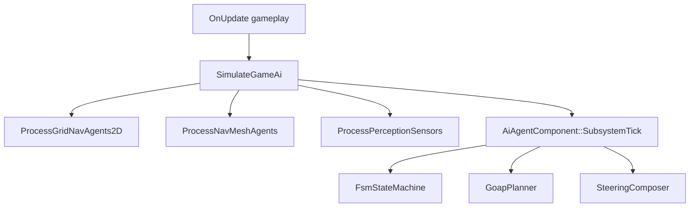

# AI Overview

Spark AI is **ECS-driven**: `AiAgentComponent` hosts steering, optional FSM/GOAP/fuzzy modules, and path polylines. The engine does **not** auto-tick AI — call `SimulateGameAi` after physics (or before, per your demo) from `OnUpdate`.

**Component usage:** [AI chapter](../7-game-components-usage/10-ai-audio-world.md) · **Demos:** `Maze3DDemo` (#9), `SteeringShowcase3DDemo`, `GameFlow2DProductPathDemo` (grid nav).

## Architecture



## Tick order (recommended)

| Step | API |
|------|-----|
| 1 | `Game::OnUpdate` — input, animation |
| 2 | `PhysicsSubsystem::Simulate*` |
| 3 | `SimulateGameAi` |
| 4 | Gameplay rules using post-move transforms |

## Concept: enable AI on the world

### C++

```cpp
#include "spark/ai/GameAiSubsystem.hpp"

void OnUpdate(const FrameTiming& timing, IEngineContext& context) override {
    Game::OnUpdate(timing, context);
    physics.SimulateAll3D(GetWorld(), timing);
    SimulateGameAi(GetWorld(), timing, context);
}
```

### C\#

```csharp
public override void OnUpdate(FrameTiming timing, IEngineContext context)
{
    base.OnUpdate(timing, context);
    _physics.SimulateAll3D(World, timing);
    GameAi.Simulate(World, timing, context);
}
```

### Python

```python
def on_update(self, timing, context):
    super().on_update(timing, context)
    context.physics.simulate_all_3d(self.world, timing)
    # SimulateGameAi when host wires game_ai.simulate(world, timing, context)
```

## Concept: patrol guard (3D)

Pair `PatrolPathComponent` (on a path object) + `NavMeshAgentComponent` + `AiAgentComponent` + optional `PerceptionSensorComponent`.

### C++

```cpp
PatrolPathComponent* patrol = patrolGo->AddComponent<PatrolPathComponent>();
patrol->SetLooping(true);
patrol->GetWaypoints().PushBack({0, 0, 0});
patrol->GetWaypoints().PushBack({leg, 0, leg});

NavMeshAgentComponent* nav = guard->AddComponent<NavMeshAgentComponent>();
nav->SetPatrolPathObject(patrolGo);

AiAgentComponent* agent = guard->AddComponent<AiAgentComponent>();
agent->SetMaxSpeed(3.2F);
agent->SetSteeringPlane(AiSteeringPlane::XzWorld);

PerceptionSensorComponent* perc = guard->AddComponent<PerceptionSensorComponent>();
perc->SetSightRadius(9.5F);
perc->SetSightFovDegrees(130.0F);
```

### C\#

```csharp
var patrol = patrolGo.AddPatrolPath();
patrol.SetLooping(true);
var nav = guard.AddNavMeshAgent();
nav.SetPatrolPathObject(patrolGo);
guard.AddAiAgent().SetMaxSpeed(3.2f);
guard.GetOrAddComponent<PerceptionSensorComponent>()?.SetSightRadius(9.5f);
```

### Python

```python
patrol_go.get_or_add_default_component(ComponentKind.PatrolPath)
guard.get_or_add_default_component(ComponentKind.NavMeshAgent)
guard.get_or_add_default_component(ComponentKind.AiAgent)
```

## `AiAgentComponent` modules

| Module | Flag | Role |
|--------|------|------|
| Blackboard | always | Shared floats/ints for steering |
| FSM | `SetFsmEnabled` | Discrete states |
| GOAP | `SetGoapEnabled` | Action planning |
| Path | implicit | `pathWorldXZ` from nav or grid |
| Steering | — | `maxSpeed`, `AiSteeringPlane` |

### C++

```cpp
agent->SetMaxSpeed(6.0F);
agent->SetSteeringPlane(AiSteeringPlane::XyRigidbody2D);  // 2D platformer enemies
agent->SetFsmEnabled(true);
```

### C\#

```csharp
agent.SetSteeringPlane(AiSteeringPlane.XyRigidbody2D);
agent.SetFsmEnabled(true);
```

### Python

```python
agent = enemy.get_or_add_default_component(ComponentKind.AiAgent)
```

## Steering planes

| `AiSteeringPlane` | Use |
|-------------------|-----|
| `XzWorld` | 3D top-down / maze guards |
| `XyRigidbody2D` | Side-view enemies with `Rigidbody2D` |

2D grid games: prefer `GridNavAgent2DComponent` + `GridPathFollower2DComponent` — [Pathfinding](05-pathfinding.md).

Hands-on guard/maze stack: [Perception, nav, and blackboard](06-perception-nav-and-blackboard.md) (**demo #8**).

Next: [Steering Behaviors](02-steering.md).
