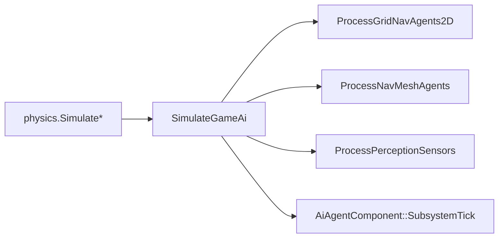

# Perception, nav agents, and blackboard

SparkDemo **#8 — 3D maze** (`Maze3DDemo`) and **#14 — 3D steering** (`SteeringShowcase3DDemo`) show how **sensing**, **path polylines**, and **`AiBlackboard`** slots compose into guard/chase behavior without a separate AI middleware.

**Walkthrough:** [Maze AI](../9-3d-game/09-maze-ai-and-perception.md) · **Path primitives:** [Pathfinding](05-pathfinding.md) · **Part 7:** [AI components](../7-game-components-usage/10-ai-audio-world.md).

## Demo map

| Demo | Key | Focus |
|------|-----|--------|
| `Maze3DDemo` | **#8** | Patrol path, `NavMeshAgent`, perception HUD |
| `SteeringShowcase3DDemo` | **; / 14** | Seek / wander / separation weights |
| `Platformer2DDemo` | **#6** | 2D steering plane, simple chase |
| `GameFlow2DProductPathDemo` | **F** | Grid nav + AI tick order |

## AI frame flow



Call **`SimulateGameAi` after physics** so agents read settled transforms. Order inside `SimulateGameAi`: grid nav → nav mesh agents → perception → agent steering/FSM.

---

## Concept: perception sensor (sight + hearing)

`ProcessPerceptionSensors` fills `PerceptionSensorComponent::GetDetectedObjects()` using **FOV cone** (`sightRadius`, `sightFovDegrees`) and **hearing sphere** (`hearingRadius`). Forward is the owner’s **−Z** in world space (guard mesh rotation matters).

### C++

```cpp
#include "spark/ecs/components/ai/PerceptionSensorComponent.hpp"

auto* guardPerception = guard->AddComponent<PerceptionSensorComponent>();
guardPerception->SetSightRadius(9.5F);
guardPerception->SetSightFovDegrees(130.0F);
guardPerception->SetHearingRadius(6.0F);
```

After `SimulateGameAi`, gameplay reads detections (`Maze3DDemo` sets HUD to **ALERT** when player is in the list):

### C++

```cpp
for (GameObject* detected : guardPerception->GetDetectedObjects()) {
    if (detected == playerGo) {
        guardAlert = true;
    }
}
```

**Note:** Line-of-sight occlusion (wall ray tests) is **not** applied yet — tune radius/FOV inside maze cells until geometry blocking is added.

### C\#

```csharp
guard.AddPerceptionSensor()
    .SetSightRadius(9.5f)
    .SetSightFovDegrees(130f);
```

### Python

```python
guard.get_or_add_default_component(ComponentKind.PerceptionSensor)
```

Wire perception into FSM: copy detection into blackboard floats, then transition in `OnTick` — [FSM — transition on perception](03-fsm.md#concept-transition-on-perception).

---

## Concept: patrol path authoring (3D)

`NavMeshAgentComponent` does **not** bake a navmesh asset today. It builds an **`AiAgent` world XZ polyline** from:

1. **`PatrolPathComponent` waypoints** on a path object (demo **#8**), or  
2. Optional **grid A\*** when `SetUseGridPathfinding(true)` and blackboard floats **0 / 1** hold goal XZ.

### C++

```cpp
#include "spark/ecs/components/ai/PatrolPathComponent.hpp"
#include "spark/ecs/components/ai/NavMeshAgentComponent.hpp"

GameObject* pathGo = world.CreateGameObject("PatrolPath");
auto* patrol = pathGo->AddComponent<PatrolPathComponent>();
patrol->SetLooping(true);
patrol->GetWaypoints().PushBack({0.0F, 0.0F, 0.0F});
patrol->GetWaypoints().PushBack({12.0F, 0.0F, 0.0F});
patrol->GetWaypoints().PushBack({12.0F, 0.0F, 12.0F});

guard->AddComponent<NavMeshAgentComponent>()->SetPatrolPathObject(pathGo);
guard->AddComponent<AiAgentComponent>()->SetMaxSpeed(3.2F);
guard->GetComponent<AiAgentComponent>()->SetSteeringPlane(AiSteeringPlane::XzWorld);
```

`ProcessNavMeshAgents` runs **before** `AiAgent` integrates steering along `pathWorldXZ`.

### Grid pursuit (maze-style chase extension)

```cpp
NavMeshAgentComponent* nav = guard->GetComponent<NavMeshAgentComponent>();
nav->SetUseGridPathfinding(true);
nav->SetGridOriginXZ({originX, originZ});
nav->SetGridCellSize(kCellWorld);
nav->SetGridWidth(kMazeW);
nav->SetGridHeight(kMazeH);

AiBlackboard& bb = agent->GetBlackboard();
bb.SetFloat(0, playerPos.x);  // goal X
bb.SetFloat(1, playerPos.z);  // goal Z
```

Fill walkability bitmap from maze wall cells before `FindPath4` inside `NavMeshAgentComponent::SubsystemTick`.

### C\#

```csharp
guard.AddNavMeshAgent().SetPatrolPathObject(pathGo);
```

### Python

```python
guard.get_or_add_default_component(ComponentKind.NavMeshAgent)
```

---

## Concept: blackboard slots

`AiBlackboard` stores floats/ints keyed by **slot index**. Reserved combat slots:

| Slot constant | Use |
|---------------|-----|
| `kAiBlackboardIntSprite2DCombatCommand` | 2D anim FSM attack/hurt |
| `kAiBlackboardIntCharacter3DCombatCommand` | 3D anim FSM combat |

Steering demos use slots **0/1** for target XZ. Document slot usage per enemy prefab to avoid collisions.

### C++

```cpp
#include "spark/ai/AiBlackboardCharacter3DAnim.hpp"

AiBlackboard& bb = agent->GetBlackboard();
bb.SetInt(kAiBlackboardIntCharacter3DCombatCommand, attackCmd);
```

### C\#

```csharp
agent.GetBlackboard().SetFloat(0, targetX);
```

### Python

```python
# Blackboard int/float setters when host exposes AiAgent wrappers.
```

---

## Concept: steering showcase (**#14**)

Open demo **#14** to tune **`SteeringComposer`** weights (seek, wander, separation). Same `AiAgentComponent` tick drives XZ acceleration; useful for crowds and debug vectors.

### C++

```cpp
#include "spark/ai/steering/SteeringBehaviors3D.hpp"

agent->SetSteeringPlane(AiSteeringPlane::XzWorld);
agent->SetMaxSpeed(4.5F);
// Compose behaviors in demo or custom AiAgent pre-tick hook.
```

Pair with perception: on `ALERT`, raise seek weight toward player position in blackboard slots 0/1.

### C\#

```csharp
agent.SetSteeringPlane(AiSteeringPlane.XzWorld);
```

### Python

```python
agent.get_or_add_default_component(ComponentKind.AiAgent)
```

---

## Level design checklist (3D guards)

| Step | Action |
|------|--------|
| 1 | `PatrolPathComponent` or grid bounds matching level |
| 2 | `NavMeshAgent` + `AiAgent` on guard; `SimulateGameAi` each frame |
| 3 | `PerceptionSensor` on guard; tag/category filters when you add layers |
| 4 | Gameplay reads `GetDetectedObjects()` → blackboard → FSM or chase grid mode |
| 5 | Physics static walls block player, not perception (until LOS ray added) |

2D equivalent: `GridNavAgent2D` + tilemap grid frame — [Tilemap gameplay API](../8-2d-game/09-2d-gameplay-api-guide.md).

---

## Debugging

| Symptom | Check |
|---------|--------|
| Guard frozen | `NavMeshAgent` enabled? Patrol waypoints non-empty? |
| No ALERT | `SimulateGameAi` called? Player transform inside FOV? |
| Path snaps wrong | Patrol path object transform; looping duplicates first waypoint |
| Steering jitter | Lower `SetMaxSpeed`, add separation weight in **#14** |

Part 4 complete → **Part 5**: [Physics Overview](../5-physics/01-physics-overview.md).
