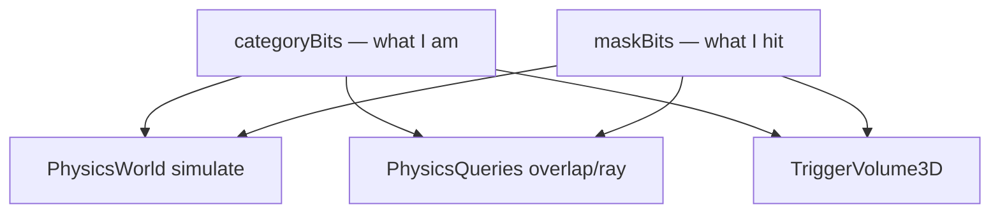

# Collision layers and filters

2D and 3D physics share the same **16-bit category/mask** rules (`CollisionFilter2D` / `CollisionFilter3D`). Layer bits decide **who collides, queries, and triggers whom**.

**Showcases:** SparkDemo **#7** (`BroadPhase2DDemo`) · **#29 / P** (`PhysicsShowcase3DDemo`) · [Physics 3D product path](../9-3d-game/08-physics-3d-product-path.md).

## Named 3D layers

From `PhysicsLayers3D` (index → `CollisionFilter3D::LayerBit(index)`):

| Index | Name | Typical use |
|-------|------|-------------|
| 0 | `Environment` | Static floor, walls |
| 1 | `Player` | Character controller / capsule |
| 2 | `Enemy` | Dynamic crates, NPC bodies |
| 3 | `Projectile` | Hitscan balls, thrown props |
| 4 | `Trigger` | Goal zones, pickups (overlap only) |

2D games use the same bitmask API on `BoxCollider2D`, `CircleCollider2D`, `Hurtbox2D`, etc. — platformer hurtboxes set custom category bits in `Platformer2DDemo`.

## Filter rule

Collision occurs when **both** sides allow the other:

```text
ShouldCollide(catA, maskA, catB, maskB)
  = (catA & maskB) != 0 && (catB & maskA) != 0
```

Queries and triggers honor the same masks when filters are passed.



---

## Concept: assign layers on colliders (3D showcase)

Pattern from `PhysicsShowcase3DDemo`:

### C++

```cpp
#include "spark/physics/CollisionFilter3D.hpp"

using namespace Spark;
using namespace CollisionFilter3D;
using namespace PhysicsLayers3D;

boxCollider->SetCategoryBits(LayerBit(Environment));
boxCollider->SetMaskBits(AllLayersMask());

playerController->SetCategoryBits(LayerBit(Player));
playerController->SetMaskBits(
    LayerBit(Environment) | LayerBit(Enemy));

goalTrigger->SetCategoryBits(LayerBit(Trigger));
goalTrigger->SetMaskBits(LayerBit(Player));

shotSphere->SetCategoryBits(LayerBit(Projectile));
shotSphere->SetMaskBits(LayerBit(Environment) | LayerBit(Enemy));
```

Use `PhysicsLayer3DComponent` when one object’s filter should apply to **all** child colliders.

### C\#

```csharp
collider.SetCategoryBits(CollisionFilter3D.LayerBit(PhysicsLayers3D.Player));
```

### Python

```python
collider.set_category_bits(...)
```

---

## Concept: 2D combat layers

Hurtboxes, hitboxes, and tilemap colliders each carry category/mask. Combat queries (`CombatHurtboxWorldQuery2D`) respect filters so punches hit enemies but not pickups.

### C++

```cpp
hurtbox->SetCategoryBits(kPlayerHurtboxCategoryBits);
hurtbox->SetMaskBits(kEnemyAttackMask);
```

Rebuild static broad-phase after tilemap collision bake — [Queries](04-queries.md).

### C\#

```csharp
hurt.SetCategoryBits(playerHurtCategory);
```

### Python

```python
hurt.get_or_add_default_component(ComponentKind.Hurtbox2D)
```

---

## Concept: query with layer filter (3D)

After `SimulateAll3D`, raycasts/overlaps use the query world synced to simulation broad-phase cell size.

### C++

```cpp
physics.GetQueries3D().RebuildStatics(world);

PhysicsRaycastHit3D hit{};
PhysicsQueryFilter3D filter{};
filter.queryCategoryBits = LayerBit(Projectile);
filter.queryMaskBits = LayerBit(Environment) | LayerBit(Enemy);

if (physics.GetQueries3D().Raycast(world, origin, dir, maxDist, filter, nullptr, hit)) {
    GameObject* struck = hit.owner;
    (void)struck;
}
```

Unified **mesh pick + physics** ray: `ScenePhysicsRaycast3D` (scene editor / interaction).

### C\#

```csharp
_physics.GetQueries3D().RebuildStatics(World);
```

### Python

```python
context.physics.get_queries_3d().rebuild_statics(world)
```

---

## Concept: broad-phase tuning (**#7**)

`BroadPhase2DDemo` visualizes **spatial hash cells** vs brute-force overlaps. Match cell size to entity spacing:

### C++

```cpp
physics.SetBroadPhaseCellSize2D(8.0F);
physics.GetQueries2D().RebuildStatics(world);
```

3D default cell size: `PhysicsWorld3D::DefaultBroadPhaseCellSize` (showcase uses `SimulateAll3D` to keep queries aligned).

### C\#

```csharp
_physics.SetBroadPhaseCellSize2D(8f);
```

### Python

```python
context.physics.set_broad_phase_cell_size_2d(8.0)
```

---

## Design patterns

| Scenario | Recipe |
|----------|--------|
| Player walks on ground | Player mask includes `Environment` |
| Projectiles ignore player | Omit `Player` from projectile mask |
| Trigger volumes | `Trigger` category; mask only `Player` |
| Friendly fire off | Separate `Projectile` masks per team bit |
| 2D only UI hit tests | Layer excludes gameplay hurtboxes |

---

## Debugging

| Symptom | Check |
|---------|--------|
| Everything collides | Mask still `AllLayersMask()` on both sides |
| Triggers never fire | Trigger category/mask vs probe body layer |
| Ray ignores prop | Dynamic catalog stale — simulate before query |
| 2D tunneling | Smaller cells + more substeps ([Tips](06-tips.md)) |

Next: [Triggers, contacts, and showcase patterns](09-triggers-contacts-and-showcase.md).
