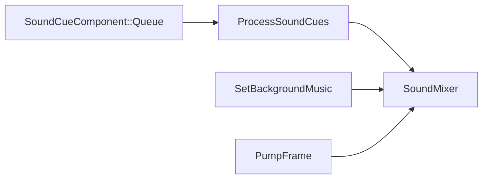

# Sound Engine

Audio is **software mixed** on the main thread: `Engine::Run` pumps `SoundEngine` after `OnUpdate`. Entity one-shots use `SoundCueComponent`; `ProcessSoundCues` runs in `Game::OnUpdate`.

**Components:** [Sound cue](../7-game-components-usage/10-ai-audio-world.md#soundcuecomponent).

## Architecture



## Concept: background music

### C++

```cpp
void OnAttach(IEngineContext& context) override {
    if (SoundEngine* se = context.TryGetSoundEngine()) {
        SharedPtr<SoundClip> bgm = TryLoadSoundClipFromBundledAsset("assets/audio/time_for_adventure.wav");
        if (bgm) se->SetBackgroundMusic(bgm, 0.32F, true);
    }
}
```

### C\#

```csharp
if (context.TryGetSoundEngine() is { } se)
    se.SetBackgroundMusic(bgmClip, 0.32f, loop: true);
```

### Python

```python
def on_attach(self, context):
    se = context.try_get_sound_engine()
    if se is not None:
        se.set_background_music("assets/audio/time_for_adventure.wav", 0.32, loop=True)
```

## Concept: one-shot via cue component

### C++

```cpp
#include "spark/ecs/components/audio/SoundCueComponent.hpp"

player->AddComponent<SoundCueComponent>()->Queue(jumpSfx, 0.9F);
// Game::OnUpdate → ProcessSoundCues → ProcessAudioListeners → spatial pan
```

Mount `AudioListenerComponent` on camera for 3D panning.

### C\#

```csharp
player.AddSoundCue().Queue(jumpSfx, 0.9f);
camera.AddAudioListener();
```

### Python

```python
player.get_or_add_default_component(ComponentKind.SoundCue)
camera.get_or_add_default_component(ComponentKind.AudioListener)
```

## Procedural fallback

When WAV missing, `Platformer2DDemo` uses `SoundClip::CreateToneBlip` — [Sound Clips](02-clips.md).

## Ambient zones

`AmbientZoneComponent` scales volume and low-pass when the listener is inside the box — [Ambient zones & music](05-ambient-zones-and-mix.md).

Next: [Sound Clips](02-clips.md).
