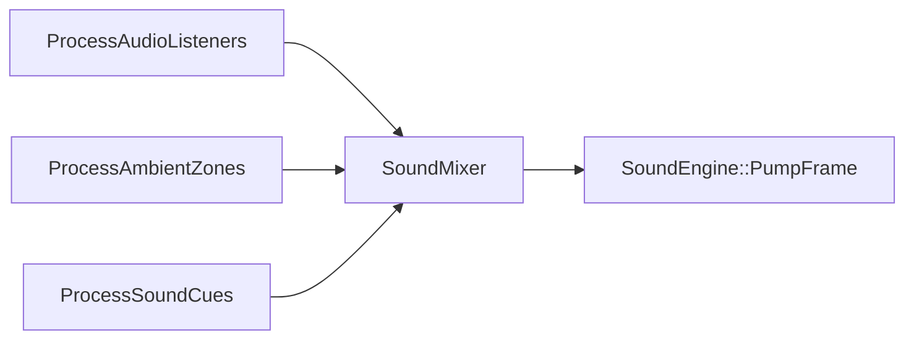

# Spatial audio and listeners

Spark mixes audio on the main thread. **Spatial cues** pan and attenuate by distance from the active **`AudioListener`** pose. Demos **#6**, **#7**, **#8**, and **#29** queue one-shots through `SoundCueComponent`.

**Basics:** [Sound engine](01-sound-engine.md) · [Clips](02-clips.md) · **Part 7:** [Sound cue](../7-game-components-usage/10-ai-audio-world.md#soundcuecomponent).

## Pipeline



`Game::OnUpdate` runs cue + listener processors before the engine pumps samples.

---

## Concept: mount listener on camera

Highest **`AudioListenerComponent::priority`** wins. Mount on the player camera in 3D; 2D games often use a single listener on the follow camera.

### C++

```cpp
#include "spark/ecs/components/audio/AudioListenerComponent.hpp"

camera->AddComponent<AudioListenerComponent>()->SetPriority(10);
```

When **no** listener is present, `ProcessAudioListeners` falls back to the **main 3D camera** pose (`AudioSpatial.cpp`).

### C\#

```csharp
camera.AddAudioListener().SetPriority(10);
```

### Python

```python
camera.get_or_add_default_component(ComponentKind.AudioListener)
```

---

## Concept: 2D one-shots (non-spatial)

Default `Queue` uses **spatialBlend = 0** — full-volume UI/jump sounds.

### C++

```cpp
#include "spark/ecs/components/audio/SoundCueComponent.hpp"

player->GetComponent<SoundCueComponent>()->Queue(jumpClip, 0.95F);
```

`Platformer2DDemo` uses procedural fallbacks when WAV assets are missing.

### C\#

```csharp
player.GetSoundCue()?.Queue(jumpClip, 0.95f);
```

### Python

```python
player.get_or_add_default_component(ComponentKind.SoundCue).queue_preset(...)
```

---

## Concept: 3D positional cue

`QueueAtWorld` sets **`spatialBlend = 1`** by default and uses owner/world position at flush time. `SoundMixer::PlayOneShotSpatial` applies **distance attenuation** and **left/right pan** from listener right vector.

### C++

```cpp
SoundCueComponent* sfx = gem->GetComponent<SoundCueComponent>();
const Vector3 worldPos = gem->GetWorldMatrix().TranslationVector();
sfx->QueueAtWorld(
    collectClip,
    0.95F,
    worldPos,
  /* spatialBlend */ 1.0F,
  /* minDistance */ 1.0F,
  /* maxDistance */ 48.0F);
```

`Maze3DDemo` gem pickup uses `DemoAudio::QueueCue` on the player object with world-position helpers — same subsystem path.

### C\#

```csharp
cue.QueueAtWorld(clip, 0.95f, worldPos, spatialBlend: 1f, minDistance: 1f, maxDistance: 48f);
```

### Python

```python
cue.queue_at_world_preset(ProceduralSoundPreset.Collectible, 0.9, world_pos)
```

---

## Concept: bundled + procedural shortcuts

### C++

```cpp
cue->QueueBundledClip("assets/audio/jump.wav", 0.9F);
cue->QueueAtWorldPreset(ProceduralSoundPreset::Impact, 0.85F, impactPos);
```

`ProceduralSoundPresets` keeps demos audible without shipping large WAV banks.

### C\#

```csharp
cue.QueuePreset(ProceduralSoundPreset.Collectible, 0.9f);
```

### Python

```python
cue.queue_bundled_clip("assets/audio/jump.wav", 0.9)
```

---

## Concept: animation / combat SFX attachment

Attach **`SoundCueComponent`** to the object that should own audio state (player root, not detached mesh). For hit-stop frames, queue on the defender’s cue component so multiple voices multiplex in `SoundMixer`.

Combat demos (`Platformer2DDemo`, `BroadPhase2DDemo`) queue hurt/explosion on the player or enemy root at event time — pair with [Cues](03-cues.md) signal wiring.

---

## Tuning table

| Parameter | Effect |
|-----------|--------|
| `spatialBlend` | 0 = 2D fullscreen, 1 = full 3D pan/attenuation |
| `minDistance` | Inside radius → near full volume |
| `maxDistance` | Beyond → silent |
| Listener priority | Split-screen: higher priority ear wins |

---

## Debugging

| Symptom | Check |
|---------|--------|
| All sounds center | `spatialBlend` 0 or missing listener |
| No audio | `SoundEngine` null? muted system volume? |
| Cues dropped | Voice pool saturated — reduce rapid `Queue` spam |
| Wrong pan | Listener on inactive camera; raise priority |

Next: [Ambient zones and music beds](05-ambient-zones-and-mix.md).
